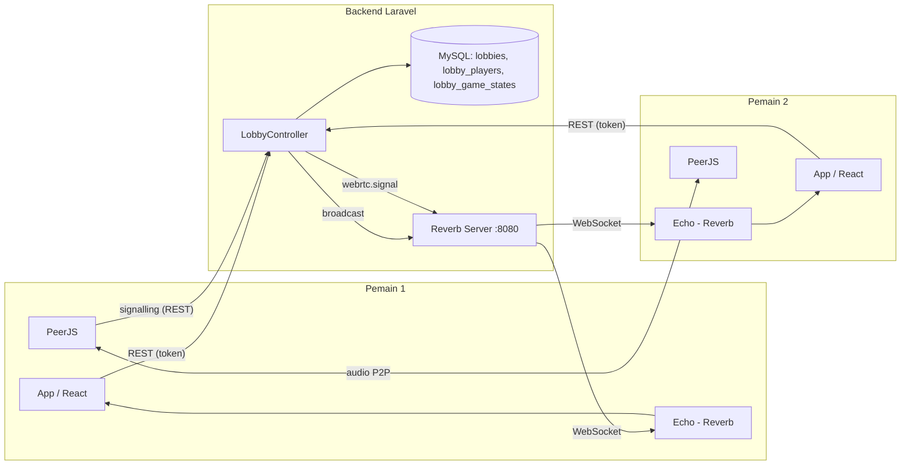
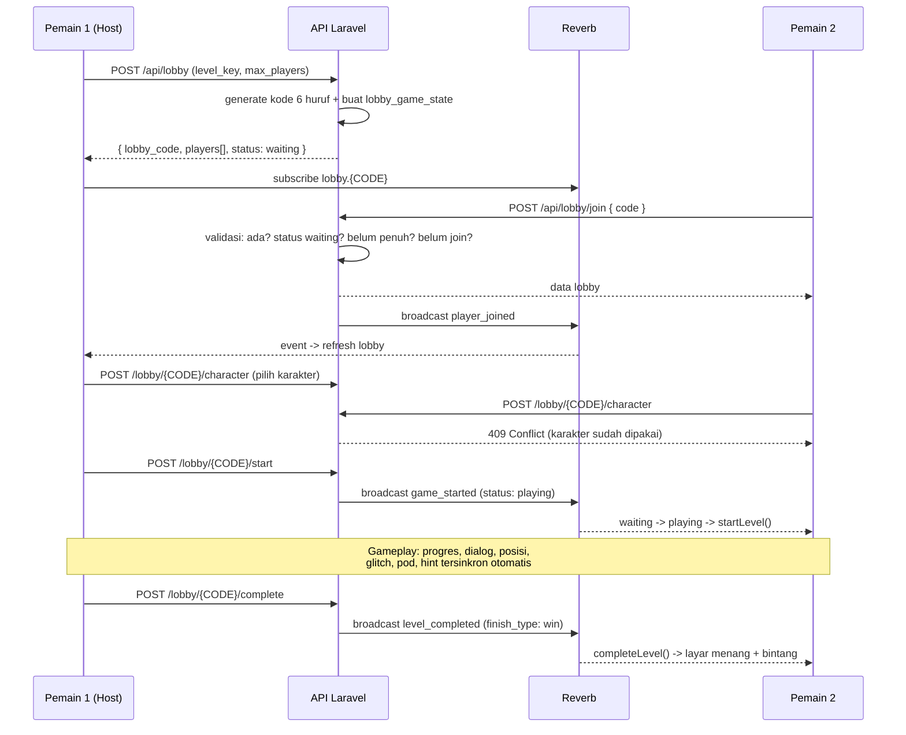

# Teknologi yang dipakai — The Paradox Room (Escape Room)

- **Frontend detail** → lihat [`FRONTEND_STACK.md`](./FRONTEND_STACK.md) (React, Zustand, struktur, hook, data layer, realtime client).
- **Game flow** → lihat [`GAME_FLOW.md`](./GAME_FLOW.md).

Dokumen lengkap arsitektur, teknologi, dan alur data project ini.

Dua repo yang bekerja sama:

- **`escape-room`** — frontend / game (React + Vite), dev di `http://localhost:5173`
- **`escape-room-api`** — backend + admin panel (Laravel + Filament), API di `http://localhost:8000`, WebSocket Reverb di `:8080`

---

## Daftar isi
1. Gambaran besar arsitektur
2. Frontend — React (folder, state, komponen)
3. Backend — Laravel (API, auth, admin panel)
4. Database — tabel & hubungan
5. Realtime — Reverb vs PeerJS/WebRTC (voice chat)
6. Keamanan
7. Build, deploy, dan testing
8. Glosarium singkat
9. TODO / catatan sisa

---

## 1. Gambaran besar

```mermaid
flowchart LR
    subgraph FE[escape-room — Frontend]
        R[React 18 + TypeScript<br/>Vite dev :5173]
        Z[Zustand store]
        Echo[laravel-echo + pusher-js]
        Peer[PeerJS]
    end

    subgraph BE[escape-room-api — Backend]
        API[Laravel REST API :8000]
        Fil[Filament Admin /admin]
        RV[Laravel Reverb WS :8080]
    end

    DB[(MySQL escape_room\nlocalhost:3306)]

    FE -->|fetch REST| API
    FE -->|WebSocket| RV
    FE <-->|WebRTC P2P\n(audio suara)| Peer
    API --> DB
    Fil --> DB
```

Aliran request paling umum: aplikasi dibuka → halaman game men-fetch `/api/levels` → level di-render (scene, hotspot, puzzle) → pemain main → progress/achievement disimpan ke API → dipantulkan balik ke UI.

---

## 2. Frontend (React + Vite)

### 2.1 Teknologi inti

| Teknologi | Versi | Dipakai untuk | Kode utama |
|---|---|---|---|
| React | 18.3 | Semua UI game | `src/components/*` |
| TypeScript | 5.5 | Tipe seluruh kode | `tsconfig.json`, `*.d.ts` |
| Vite | 5.4 | Dev server (`npm run dev`) + build (`npm run build` → `dist/`) | `vite.config.ts` |
| Zustand | 4.5 | State store tunggal game | `src/store/gameStore.ts` |
| laravel-echo | 2.x | Klien WebSocket Reverb | `src/echo.ts` |
| pusher-js | 8.6 | Driver protokol Pusher (dipakai Reverb) | `src/echo.ts` |
| PeerJS | 1.5 | Voice chat P2P (WebRTC) | `src/hooks/useVoiceChat.ts` |

### 2.2 Struktur folder

```
src/
├─ components/          # Komponen UI (Layar per game screen)
│  ├─ Splash/           # Main menu ("START", "MULTIPLAYER", "ACHIEVEMENTS", …)
│  ├─ Auth/             # Login / register / guest
│  ├─ LevelSelect/      # Pilih level (level grid + tooltip bintang)
│  ├─ LoadingScreen/    # Preloader aset (gambar + audio)
│  ├─ Dialog/           # DialogScreen (prolog) & SceneDialogOverlay (dalam game)
│  ├─ Comic/            # ComicScene (komik cutscene)
│  ├─ GameScene/        # Layar gameplay (scene + hotspot + tombol puzzle)
│  ├─ Level7/           # Khusus level 7 (CharacterSelect, Monitor, Desktop OS, dll.)
│  ├─ PuzzleModal/      # Semua jenis puzzle (keypad, pattern, safe, computer, …)
│  ├─ Achievement/      # AchievementScreen + AchievementPopup
│  ├─ Treasure/         # TreasureScreen (galeri treasure)
│  ├─ HUD/              # Timer, scene navigator, hint token, clue counter
│  ├─ Lobby/            # Multiplayer lobby (create/join/start/room)
│  ├─ Settings/         # Opsi game
│  └─ WinScreen/        # Win & Lose screen
├─ store/gameStore.ts   # Zustand — state tunggal game
├─ hooks/               # useapi (fetch), useLobby, useVoiceChat, useChat, useTimer, …
├─ lib/                 # assetPath, apiMap, multiplayer, treasureImage, characterFlow
├─ data/                # Level 1–7 hardcoded (fallback + L6/L7 dinamis)
└─ types/game.types.ts  # Kontrak tipe data game
```

### 2.3 State management — Zustand

Kenapa Zustand? Tidak perlu Provider boilerplate; satu store bisa diakses dari mana pun (komponen, util di luar React, bahkan `multiplayer.ts`).

Isi store (`useGameStore`):

- **`screen`** — alur layar game: `splash` → `level_select` → `gameplay` → `win` / `lose`, plus `settings`, `achievements`, `treasures`, `lobby`
- **Level runtime** — `levels[]`, `currentLevelId`, `currentSceneId`, `timeElapsed`, `solvedPuzzles`, `inventory`, `discoveredClues`, `usedHotspots`, `foundTreasures`, `newAchievement`
- **UI overlays** — `zoomModal`, `noteModal`, `activePuzzleId`, `sceneComic`, `sceneDialogOverlay`, `notification`, `isLoadingLevels`
- **Akun pemain** — `player`, `token`, `isGuest`
- **Lobby** — `lobbyCode`, `playerCharacter`, `releasedCharacter`, `scene5Character`
- **Progres** — `levelProgress` (completed, best time, bintang, per level), `unlockedAchievements`

Store juga **persist** sebagian state (mis. `foundTreasures`, `levelProgress` gamest) ke `localStorage` lewat middleware `persist`.

Pola umum: komponen panggil `useGameStore((s) => s.aksi)`; util non-React pakai `useGameStore.getState()`.

### 2.4 Alur prolog level (App.tsx)

`showLoading → (comicSrc? → ComicScene) → introDialog? → DialogScreen → startLevel(levelId) → GameScene`

`pendingLevelId` menentukan level mana yang sedang dibuka; setelah prolog selesai, `startLevel()` di store dijalankan dan berpindah ke layar `gameplay`.

### 2.5 Asset resolving (upload dari admin)

- `src/lib/assetPath.ts` — mengubah path relatif dari API (`achievements/x.png`) menjadi `/storage/achievements/x.png` supaya browser bisa memuatnya; path absolut tetap apa adanya.
- `src/lib/apiMap.ts` — mapping respons API → tipe game (dialog, scene dialogs, achievement, treasure), termasuk konversi style avatar ke angka.
- `src/lib/multiplayer.ts` — pemilik tunggal channel Reverb (semua modul lain hanya subscribe).

---

## 3. Backend — Laravel (API + Admin Panel)

### 3.1 Teknologi inti

| Teknologi | Kegunaan | File |
|---|---|---|
| PHP 8 + **Laravel 13** | Framework web (routing, Eloquent ORM, middleware, exception) | `app/`, `routes/`, `config/` |
| **Laravel Sanctum** | Auth API pakai Bearer token (personal access tokens) | `app/Http/Controllers/Api/AuthController.php`, `personal_access_tokens` table |
| **Filament 3.3** | Admin panel CRUD konten game | `app/Filament/Admin/*` |
| **Laravel Reverb** | Server WebSocket (naik ke port 8080) | `config/broadcasting.php`, `app/Events/*`, `config/reverb.php` |
| **MySQL** | Database utama production | `escape_room` di `127.0.0.1:3306` |
| **SQLite `:memory:`** | Database untuk test phpunit | `phpunit.xml` |
| PHP Unit | Test admin (smoke test) | `tests/Feature/AdminSmokeTest.php` |
| Tinker | REPL debugging | `php artisan tinker` |
| Pint | Auto-formatting PHP | `vendor/bin/pint` |

### 3.2 Struktur backend

```
escape-room-api/
├─ app/
│  ├─ Filament/Admin/Resources/      # CRUD admin (index/create/edit tiap resource)
│  ├─ Filament/Admin/Pages/          # SceneDialogs (editor dialog per-scene)
│  ├─ Filament/Forms/Components/     # ImagePathUpload (field kustom: path + upload + preview)
│  ├─ Http/Controllers/Api/          # REST API (LevelController, AuthController, LobbyController…)
│  ├─ Http/Controllers/Admin/        # UploadController (upload gambar dari admin)
│  ├─ Models/                        # Eloquent models
│  ├─ Events/                        # GameStateUpdated, ChatMessageSent, WebRTCSignal
│  └─ Providers/Filament/            # Panel admin (path /admin, guard web)
├─ routes/api.php                    # Semua route /api/*
├─ routes/web.php                    # Route web (admin uploads)
├─ database/migrations/              # Skema DB
├─ database/seeders/                 # Seed level 1–7
└─ tests/Feature/AdminSmokeTest.php  # 4 test (render semua halaman admin, upload, scene dialogs)
```

### 3.3 REST API — ringkasan endpoint

Public (tanpa login):

| Method & path | Kegunaan |
|---|---|
| `GET /api/levels` | Daftar semua level + achievements & treasures (halaman level select) |
| `GET /api/levels/{key}` | Detail penuh satu level (scenes, hotspots, puzzles, hints, dialog, achievements, treasures) |
| `GET /api/hint-config` | Konfigurasi hint token (max token & refill interval) |
| `GET /api/achievements` | Daftar semua achievements |
| `GET /api/leaderboard` | Top skor per level |
| `POST /api/register`, `POST /api/login`, `POST /api/logout` | Auth pemain |

Butuh login (`auth:sanctum`):

| Method & path | Kegunaan |
|---|---|
| `GET/POST /api/progress`, `DELETE /api/progress` | Simpan/ambil best time & bintang |
| `GET/PUT /api/profile`, `POST /api/profile/avatar` | Profil pemain + avatar |
| `POST /api/achievements/unlock`, `GET /api/achievements/my` | Unlock & ambil achievement |
| `POST /api/treasures/found`, `GET /api/treasures/my` | Treasure ditemukan / daftar milik |
| `POST /api/lobby`, `POST /api/lobby/join`, `GET /api/lobby/my`, `GET /api/lobby/{code}`, `POST /api/lobby/{code}/start`, `POST /api/lobby/{code}/leave`, `POST /api/lobby/{code}/sync`, `POST /api/lobby/{code}/reset`, `POST /api/lobby/{code}/force-end`, `POST /api/lobby/{code}/complete`, `POST /api/lobby/{code}/lose`, `POST /api/lobby/{code}/exit`, `POST /api/lobby/{code}/chat`, `POST /api/lobby/{code}/input`, `POST /api/lobby/{code}/signal`, `POST /api/lobby/{code}/hint`, `POST /api/lobby/{code}/character`, `POST /api/lobby/{code}/release`, `POST /api/lobby/{code}/select-scene5-char` | Multiplayer level 7 |

### 3.4 Admin panel (Filament)

`http://localhost:8000/admin/login` — session-based, terpisah dari pemain.

Grup navigasi **Konten Game**:

| Resource | Fungsi |
|---|---|
| **Levels** | Level dasar: title, deskripsi, thumbnail, time limit, star thresholds, musik |
| **Scenes** | Scene per level: label, background image (upload/path), exit puzzle |
| **Hotspots / Objects** | Hotspot klik: posisi, kursor, gambar, aksi saat diklik (puzzle/catatan/message/…), syarat tampil |
| **Puzzles** | Kode puzzle: tipe, jawaban, pola, clue |
| **Level Hints** | Hint teks per level + urutan |
| **Dialog Lines** | Dialog prolog/win/lose: teks, karakter, avatar (upload), style avatar |
| **Scene Dialogs** | **Editor dialog dinamis per-scene** (mis. `scene7_1_item`) — khusus Level 6/7 |
| **Achievements** | Achievement: judul, deskripsi, icon (upload), tipe (time/treasure), golden, batas waktu |
| **Treasures / Objects** | Treasure: posisi, gambar, level, achievement terkait |

Grup **Pemain & Progress**: **Players** — kelola akun pemain (progress & achievements relation manager).

Halaman khusus: **Dashboard** (Filament bawaan), **Scene Dialogs** (custom page tanpa tabel — select level → grup dialog → repeater baris dialog).

Fitur upload aset: tombol Upload di samping input path — file disimpan ke `storage/app/public/{direktori}/`, path otomatis terisi. URL game mengakses via `/storage/...` (di-symlink ke `public/storage`).

---

## 4. Database (MySQL `escape_room`)

Tabel utama dan fungsinya:

| Tabel | Fungsi |
|---|---|
| `levels` | Level game (level_key, title, time_limit, star_thresholds, music, dialog_music, is_locked, order, + JSON scene_hints/comics/dialogs) |
| `scenes` | Scene per level (scene_key, background_image, char1/2/3_layer JSON, comic_pages JSON, intro_dialog JSON, exit_puzzle_id, highlight_hotspots) |
| `hotspots` | Hotspot klik (x/y/width/height, cursor, image, action_type, action_data JSON, visible_data JSON) |
| `puzzles` | Definisi puzzle (puzzle_key, type, answer, pattern_size, symbol_answer JSON, extra_data JSON) |
| `level_hints` | Daftar hint per level (text, order) |
| `dialog_lines` | Baris dialog intro/win/lose (character, avatar, avatar_left/right + style JSON, side, is_system, order) |
| `achievements` | Achievement (achievement_key, title, icon, type enum(time,treasure), is_golden, time_threshold, order) |
| `treasures` | Treasure tersembunyi (treasure_key, x/y/width/height, image, achievement_id FK) |
| `leaderboard` | Skor (level_id FK, player_name, time_elapsed, stars) |
| `players` | Akun pemain (username, email, password hash, avatar, bio) |
| `player_progress` | Progress per level per pemain (best_time, stars, completed) |
| `player_achievements` | Achievement yang sudah dibuka oleh pemain |
| `player_treasures` | Treasure yang sudah ditemukan pemain |
| `lobbies` | Lobby multiplayer (kode 6–8 karakter, host_id, level_key, status, max_players) |
| `lobby_players` | Pemain dalam lobby (role host/member, is_ready, character) |
| `lobby_game_states` | State shared game (solved_puzzles, inventory, scene, timer, revision, released_character, …) |
| `sessions`, `cache`, `jobs`, `personal_access_tokens` | Infrastruktur Laravel |

Relasi ringkas: `levels` 1—N `scenes`, `levels` 1—N `hotspots`(lewat scene), `levels` 1—N `puzzles`, `achievements` 1—N `treasures`, `players` 1—N `player_progress`, `players` 1—N `player_achievements`, `lobbies` 1—N `lobby_players`.

---

## 5. Realtime (WebSocket) — dua teknologi, dua tugas

Permainan multiplayer Level 7 ini butuh dua jenis "komunikasi jarak jauh", dan keduanya sengaja dipisah:

### 5.1 Laravel Reverb — "radio pengumuman" untuk data game

- **Server**: Reverb port `:8080` (dev). Broadcast driver default = `reverb` (`BROADCAST_CONNECTION`).
- **Sisi server** — 3 event (`ShouldBroadcastNow` = broadcast langsung, tanpa queue):

| Event | Channel | Dikirim saat | Payload |
|---|---|---|---|
| `GameStateUpdated` (`.game.state.updated`) | `lobby.{kode}` | Ada perubahan state game (puzzle terpecahkan, item/treasure terambil, scene berpindah, timer pause/jalan, dll.) | `{ state, action, triggeredBy, revision }` |
| `ChatMessageSent` (`.chat.message.sent`) | `lobby.{kode}` | Pemain kirim chat | `{ username, message, sentAt }` |
| `WebRTCSignal` (`.webrtc.signal`) | `lobby.{kode}` | Sinyal WebRTC untuk voice chat | `{ from, to, signal }` |

- **Sisi klien** — `laravel-echo` + `pusher-js` (`src/echo.ts`); driver `reverb` dikonfigurasi via env `VITE_REVERB_*`.
- **Modul tunggal** `src/lib/multiplayer.ts` — satu-satunya yang subscribe/unsubscribe channel. Semua modul lain (`useLobby`, `useChat`, `store`) hanya memanggil API modul ini. Ini penting: sebelumnya `useLobby` pernah diinstansiasi 4 kali dan tiap instance punya state machine sendiri → sinkronisasi gagal.
- **`revision`** — setiap update state membawa nomor revisi yang naik; klien membuang event dengan revisi lebih kecil dari yang sudah diterapkan (mencegah "echo" menimpa state lebih baru).
- **Polling fallback** — `useLobby` melakukan polling `GET /lobby/{code}` tiap 3 detik; bila koneksi WebSocket putus, game tetap sinkron (lambat, tapi tidak macet).
- **Checkpointing penting**: transisi `waiting → playing` memicu `startLevel()` bagi semua anggota lobby (host dan member).

### 5.2 PeerJS (WebRTC) — "telepon langsung" untuk suara

- **Library**: PeerJS 1.5 (wrapper WebRTC sederhana).
- **Tujuan**: voice chat antar pemain tanpa melewati server.
- **Alur**:
  1. Pemain membuka voice → `navigator.mediaDevices.getUserMedia({ audio: true })` (speaker mute dulu, tracking bicara via `AudioContext` + `AnalyserNode`).
  2. Buat PeerJS peer dengan id `{lobbyCode}-{username}`.
  3. Kirim sinyal `ready` ke lobby (lewat Reverb event `.webrtc.signal` atau `POST /lobby/{code}/signal`).
  4. Pemain lain yang mendengar `.webrtc.signal` dari peer yang ready → langsung `peer.call(peerId, stream)` (memanggil peer yang baru siap).
  5. `call.on('stream')` → diputar di `<audio>` tersembunyi.
  6. STUN server Google (`stun.l.google.com:19302`) untuk menembus NAT.
- **Mute/unmute** — toggle `track.enabled`; indikator "sedang bicara" dari analyser level > threshold.

Jadi analoginya: **Reverb = pengeras suara balai lobby** (semua orang dengar pengumuman), **PeerJS = telepon dua arah langsung** (suara ngumpul hanya di antara yang ikut ngomong).

---

## 6. Alur data end-to-end (contoh konkret)

**Contoh: admin mengedit ikon achievement "Golden Brain (Market)"**

1. Admin buka `http://localhost:8000/admin/achievements`, ganti icon → file baru terunggah ke `storage/app/public/achievements/xxx.png`, kolom `achievements.icon` di-update.
2. Pemain buka layar Achievements → fetch `/api/achievements` + `/api/levels` → daftar achievement dengan icon `achievements/xxx.png`.
3. `resolveAssetPath` di frontend → `/storage/achievements/xxx.png`.
4. Browser meminta `http://localhost:8000/storage/achievements/xxx.png` → diserve oleh Laravel dari `storage/app/public/...` ✓.

**Contoh: pemain host menyelesaikan puzzle di Level 7**

1. Pemain klik hotspot → `solvePuzzle('puzzle_scene2')` di store.
2. Store kirim `POST /lobby/{code}/sync { action: 'puzzle_solved', ... }`.
3. Server `LobbyController@sync` update `lobby_game_states.revision++`, lalu `GameStateUpdated` di-broadcast.
4. Semua pemain (termasuk host sendiri) menerima `.game.state.updated` via Reverb → `multiplayer.ts` (`emit`) → `applySharedGameState` di store → UI semua pemain update.
5. Jika ada player yang disconnect, `useLobby` polling (3 detik) mendeteksi & menampilkan notifikasi; bila anggota keluar saat game berjalan, lainnya dikembalikan ke menu.

**Contoh: dialog intro level 1 dimainkan**

1. Pemain pilih Level 1 → `Setting pendingLevelId` → `LoadingScreen` → tidak ada `comicSrc` → tidak ada `introDialog` di file lokal → `startLevel('level_1')` dipanggil.
2. `startLevel` fetch `GET /api/levels/level_1` → mapping scenes/hotspots/puzzles/dialog_lines (dialog lines DB dipakai untuk overlay `SceneDialogOverlay` di dalam game).
3. Map tersimpan di `store.levels` (menggantikan data lokal untuk level ini).
4. GameScene dirender; hotspot & puzzle dari DB; achievements/treasures menimpa data lokal (API menang).

---

## 7. Build, menjalankan, dan testing

| Kebutuhan | Command | Keterangan |
|---|---|---|
| Install frontend | `npm install` | sekali |
| Run dev frontend | `npm run dev` | Vite `:5173` |
| Build production frontend | `npm run build` | output `dist/` |
| Install backend | `composer install` | sekali |
| Migrate + seed dev DB | `php artisan migrate --seed` | mengisi data level 1–7 |
| Run API | `php artisan serve` | `:8000` |
| Run Reverb | `php artisan reverb:start` | `:8080` |
| Admin panel | buka `http://localhost:8000/admin` | login `admin@admin.com` |
| Jalankan test backend | `php artisan test` atau `vendor/bin/phpunit` | 4 smoke test (butuh `App\Models\User::factory`) |

Persyaratan: **PHP 8.x**, **Composer**, **Node.js 18+**, **npm**, **MySQL** (Laragon/XAMPP cocok).
Untuk Level 7 multiplayer, Reverb wajib jalan (WS); untuk voice chat, browser butuh izin mikrofon.

---

## 8. Ringkasan kekuatan & batasan (jujur)

**Kekuatan**
- Satu sumber kebenaran untuk konten level (kecuali Level 7 & komik prolog) di database — bisa diubah lewat admin tanpa deploy ulang.
- State multiplayer satu jalur (satu modul Reverb) + fallback polling → tahan putus koneksi.
- Asset upload dari admin terintegrasi penuh (upload → storage → game resolusi otomatis).

**Batasan**
- Level 7 masih baca dari file lokal (`level7.ts`) — belum bisa diedit dari admin (kecuali achievements/treasures/dialogs/hints yang sudah ditimpa API).
- Komik prolog Level 6/7 tidak bisa diedit dari admin (tidak ada editor komik).
- `sceneTransitionPoints`, `exitDoorPoints`, `timeLimit`, HUD scene-navigator — baca dari file lokal, bukan DB.
- Reverb channel publik — bukan private channel; kode lobby bocor = bisa menonton state.

---

## 9. Glosarium

| Istilah | Arti |
|---|---|
| **Hotspot** | Area klik tak terlihat (atau dengan gambar) di scene yang memicu aksi saat diklik |
| **Puzzle** | Tantangan logika (keypad, pola, safe, komputer, botol kimia, …) |
| **Scene** | "Ruangan" dalam level; pemain berpindah antar scene |
| **Exit puzzle** | Puzzle terakhir yang membuka pintu keluar level |
| **Progres** | Best time & bintang per level yang disimpan server |
| **Revision** | Nomor urut update state lobby; mencegah event basi menimpa yang baru |
| **Seed** | Data awal yang dimasukkan ke DB saat setup (`db:seed`) |
| **Migration** | File PHP yang mendefinisikan/mengubah skema database secara terkontrol & berurutan |
| **Bearer token** | Token Sanctum yang dikirim di header `Authorization` untuk autentikasi API |
| **P2P / WebRTC** | Koneksi langsung antar browser tanpa relay server (dipakai voice chat) |
| **STUN** | Server yang membantu dua peer menemukan alamat jaringan masing-masing saat di balik NAT |
# Frontend — The Paradox Room (Escape Room), Deep-dive

Dokumen ini membahas **hanya frontend** (`escape-room/`) sedalam mungkin: teknologi, struktur, state management, komponen, data layer, realtime client, build, dan gotcha.

---

## Daftar isi
1. Stack & tooling
2. Struktur folder lengkap
3. State management — Zustand (`gameStore.ts`)
4. Alur aplikasi — App.tsx & state `screen`
5. Komponen — peta lengkap
6. Data layer — local data, API, mapping
7. Realtime client — Echo, multiplayer, voice chat, chat
8. Hooks — daftar & fungsi
9. Types — kontrak data
10. Styling — CSS Modules & tema
11. Assets di `public/`
12. Gotcha & catatan penting
13. Build & performa

---

## 1. Stack & tooling

| Teknologi | Versi | Peran |
|---|---|---|
| React | 18.3.1 | Library UI — semua komponen |
| TypeScript | 5.5 | Tipe statis (strict-ish via `tsconfig.json`) |
| Vite | 5.4.1 | Dev server (HMR) & bundler production |
| `@vitejs/plugin-react` | 4.3 | Fast Refresh + JSX transform |
| Zustand | 4.5.2 | State store tunggal (+ middleware `persist`) |
| laravel-echo | 2.x | Klien WebSocket (channel Reverb) |
| pusher-js | 8.6 | Driver protokol Pusher (dipakai Reverb) |
| PeerJS | 1.5.5 | Voice chat WebRTC P2P |
| CSS Modules | bawaan Vite | Scoping style per komponen |

Runtime: browser modern (ES2020+). Tidak pakai router — navigasi layar dikelola oleh Zustand `screen`, bukan React Router. Tidak ada Redux/MobX. Tidak ada CSS framework (no Tailwind).

Scripts (`package.json`):
- `npm run dev` → `vite` (localhost:5173)
- `npm run build` → `vite build` → output ke `dist/` (warning chunk besar >500 kB — perlu code splitting bila mau optimal)
- `npm run preview` → serve hasil build lokal

Environment (`.env` frontend, dibaca lewat `import.meta.env`):

```
VITE_API_URL=http://localhost:8000/api
VITE_REVERB_APP_KEY=ilhamkayshi
VITE_REVERB_HOST=localhost
VITE_REVERB_PORT=8080
VITE_REVERB_SCHEME=http
```

---

## 2. Struktur folder lengkap

```
src/
├─ main.tsx                 # Entry React: render <App/> ke #root
├─ index.css                # Reset & theme global (background #0d0015, warna teks, scrollbar)
├─ echo.ts                  # Inisialisasi laravel-echo → Reverb (singleton)
├─ App.tsx                  # Root component: screen switcher + prolog (loading/comic/dialog) + dev previews
├─ vite-env.d.ts            # Tipe env untuk import.meta.env
│
├─ types/
│  └─ game.types.ts         # Kontrak TS: Level, Scene, Hotspot, Puzzle, DialogLine, Achievement, dll.
│
├─ data/                    # Level hardcoded (fallback + sumber utama L6/L7)
│  ├─ levels.ts             # LEVEL_1..LEVEL_5 (+ export LEVELS gabungan)
│  ├─ level6.ts             # LEVEL_6 (Comeback / taman lab)
│  ├─ level7.ts             # LEVEL_7 (Broken Paradox, multiplayer)
│  ├─ desktopData.ts        # Desktop OS Level 7 (file desktop, XP, tema)
│  ├─ tapedata.ts           # Level 7 — data tape-reader (teks tape A..E)
│  └─ level6.ts / level7.ts # …
│
├─ store/
│  └─ gameStore.ts          # Zustand — SATU-SATUNYA state global (screen, level, inventory, dll.)
│
├─ hooks/
│  ├─ useapi.ts             # Fetch helper ke Laravel API (+ types ApiLevel dsb.)
│  ├─ useLevel.ts           # (legacy hook) fetch levels sederhana
│  ├─ useTimer.ts           # Timer mundur (setInterval 1s), pause/resume
│  ├─ useMusic.ts           # playMusic()/pauseMusic()/resumeMusic() — single <audio> bg music
│  ├─ useSFX.ts             # playSFX helpers (click, sukses, error, hint, win, lose, …)
│  ├─ useHintRefill.ts      # Refill hint tokens berkala berdasar config server
│  ├─ useHotspotAction.ts   # Dispatch aksi hotspot (give_item, open_puzzle, collect_treasure, …)
│  ├─ Usepuzzlesync.ts      # Sync puzzle ke lobby (multiplayer) — nama file capital U
│  ├─ useLobby.ts           # Polling lobby (3s) + transisi waiting→playing
│  ├─ useChat.ts            # Chat teks via Reverb (.chat.message.sent)
│  ├─ useVoiceChat.ts       # Voice chat PeerJS (mic, analyser, mute, stop)
│  └─ useTimer.ts …
│
├─ lib/
│  ├─ assetPath.ts          # resolveAssetPath() — path relatif → /storage/… (upload admin)
│  ├─ apiMap.ts             # Map respons API → tipe game (dialog/achievement/treasure/scene dialogs)
│  ├─ multiplayer.ts        # Channel Reverb tunggal + revisi state + applySharedGameState
│  ├─ characterFlow.ts      # Aturan alur karakter Level 7 (urutan karakter aktif, unlock)
│  └─ treasureImage.ts      # resolveTreasureImagePath() — resolver gambar treasure
│
└─ components/
   ├─ Splash/Splash.tsx                 # Main menu + entry "Press any button"
   ├─ Auth/AuthScreen.tsx               # Login / register / guest
   ├─ MainMenu/MainMenu.tsx             # (LEGACY, tidak dipakai — Splash yang menu utama)
   ├─ LevelSelect/LevelSelect.tsx       # Grid level + bintang + lock
   ├─ LoadingScreen/LoadingScreen.tsx   # Preloader gambar+audio sebelum prolog
   ├─ Dialog/
   │  ├─ DialogScreen.tsx               # Dialog prolog (typewriter, klik=teks penuh, LANJUT/SKIP)
   │  └─ SceneDialogOverlay.tsx         # Dialog overlay in-game (scene dialogs, karakter kiri/kanan)
   ├─ Comic/ComicScene.tsx              # Komik cutscene (panel reveal + sfx + shake)
   ├─ GameScene/GameScene.tsx           # Gameplay utama: scene, hotspot render, preloader, zoom modal
   │  ├─ ComputerZoom.tsx               # Zoom layar komputer (level 2/4)
   │  ├─ DoorEscapeAnimation.tsx        # Animasi pintu keluar menang (SVG clip-path)
   │  ├─ SceneTransitionAnimation.tsx   # Transisi glow antar scene (SVG clip-path)
   │  ├─ Notification.tsx               # Toast "hotspot used"/"puzzle solved" dsb.
   │  ├─ ZoomableNote.tsx               # Catatan yang bisa di-zoom & di-drag (pinch)
   │  ├─ NoteZoom.tsx                   # Catatan sederhana (zoom modal)
   │  ├─ ZoomModal.tsx                  # Modal zoom generik (object/zoomImage)
   │  └─ TreasureLayer.tsx              # Render treasure di atas scene (klik untuk koleksi)
   ├─ Level7/                            # Level 7 — subsistem terpisah
   │  ├─ Level7scene.tsx                # Scene utama multiplayer + character layers (char1/2/3)
   │  ├─ Level7SidePanel.tsx            # Panel kanan (inventory karakter + skills)
   │  ├─ Level7SidePanel.tsx            # …
   │  ├─ DesktopOS.tsx                  # "Desktop OS" fiktif (file manager, XP, repair progress)
   │  ├─ TapeReaderModal.tsx            # Tape reader (teks tape A/B/C/D/E/comic)
   │  ├─ CraftingModal.tsx              # Kombinasi item (circuit, tape, …)
   │  ├─ CharacterSelectModal.tsx       # Pilih karakter awal L7
   │  ├─ ChestModal.tsx                 # Peti (pilih item acak/pick)
   │  ├─ HandInspect.tsx                # Inspect tangan (mini-puzzle jari)
   │  ├─ MonitorOverlay.tsx             # Overlay monitor PC (hacking / cctv / brainmaze)
   │  ├─ LoginControl.tsx               # Login screen bertema "pod control"
   │  ├─ GlitchOverlay.tsx              # Overlay glitch VHS saat transisi scene
   │  ├─ Scene5GlitchBanner.tsx         # Banner glitch scene 5
   │  ├─ Level7notemodal.tsx            # Catatan Level 7
   │  └─ Level7*Comic.tsx               # Komik final/khusus L7 ( FinalComic, AllComplete )
   ├─ PuzzleModal/
   │  ├─ PuzzleModal.tsx                # Router puzzle berdasar puzzle.type
   │  ├─ KeypadPuzzle.tsx / keypadkoridor.tsx / keypadperpus.tsx   # Keypad numerik
   │  ├─ PatternPuzzle.tsx              # Pola/pattern (warna bunga L6)
   │  ├─ SequencePuzzle.tsx             # Urutan (pola warna / simbol)
   │  ├─ MazePuzzle.tsx                 # Labirin (Level 7 scene 3)
   │  ├─ BrainMazePuzzle.tsx            # "Brain maze" final L7
   │  ├─ ChemicalBottlePuzzle.tsx       # Urutkan botol kimia (L6)
   │  ├─ ColorPatternPuzzle.tsx         # Pola warna
   │  ├─ ComputerPuzzle.tsx             # Terminal komputer dengan sandi
   │  ├─ SafePuzzle.tsx                 # Brankas kombinasi
   │  ├─ LeverPuzzle.tsx                # Pola tuas (L1)
   │  ├─ SymbolPuzzle.tsx               # Pilihan simbol
   │  ├─ ArrowInputPuzzle.tsx           # Input arah (arrow keys)
   │  ├─ PatternPuzzle.tsx, DualPuzzle.tsx, ExitLockScreen.tsx, ReactorLever.tsx,
   │  ├─ HackingMinigame.tsx            # Hacking minigame (L7)
   │  ├─ PodControlPuzzle.tsx           # Kontrol pod (L7)
   │  ├─ HologramView.tsx               # Tampilan hologram (L7)
   │  ├─ ReactorSecurityModal.tsx       # Modal keamanan reaktor (L7)
   │  └─ SpotDiffrent.tsx               # Spot-the-difference (L7)
   ├─ Achievement/
   │  ├─ AchievementScreen.tsx          # Grid semua achievement (filter per level + status)
   │  └─ AchievementPopup.tsx           # Toast saat unlock (muncul di atas gameplay)
   ├─ Treasure/TreasureScreen.tsx       # Galeri treasure (filter level + zoom gambar)
   ├─ Inventory/
   │  ├─ Inventory.tsx                  # Panel "item dibawa" + alat + slot aktif
   │  └─ ToolsPanel.tsx                 # Panel khusus alat (X-Vision, translation, hacking device)
   ├─ HintSystem/HintSystem.tsx         # Panel hint (token cost, refill)
   ├─ HintToken/HintToken.tsx           # Tampilan hint token compact (top-right HUD)
   ├─ HUD/HUD.tsx                       # Timer, scene navigator, clue counter, quit, pause, hint
   ├─ Lobby/LobbyScreen.tsx             # Multiplayer lobby (host/member, kode, ready, start, chat, voice)
   ├─ Chat/ChatBox.tsx                  # Chat teks dalam lobby game
   ├─ PauseMenu/PauseMenu.tsx           # Resume / quit / settings dari dalam game
   ├─ Settings/Settings.tsx             # Volume musik+SFX, bahasa, reset progress
   ├─ Profile/                          # ProfileIcon (tombol akun) + ProfileModal (email, avatar, bio)
   ├─ Level7/CharacterSelectModal.tsx   # Pilih karakter L7 sebelum mulai
   ├─ WinScreen/WinScreen.tsx           # Layar menang (bintang, achievement baru, tombol replay)
   ├─ WinScreen/LoseScreen.tsx          # Layar kalah (retry / menu)
   └─ UI/                               # Primitif UI bersama
       ├─ SecondButton.tsx + .css       # Tombol sekunder (cokelat/metal)
       ├─ MetalButton.tsx               # Tombol metal utama (game vibe)
       ├─ BlackHoleTransition.tsx       # Transisi "black hole" antar screen
       └─ SplashTransition.tsx          # Transisi splash (background fade)
```

---

## 3. State management — Zustand (`gameStore.ts`)

### 3.1 Kenapa Zustand?

- Tidak perlu Context Provider & reducer boilerplate.
- Satu store bisa diakses dari mana saja: komponen (`useGameStore(selector)`) dan juga non-React (`useGameStore.getState()` — dipakai `multiplayer.ts`, util, dan action functions di dalam store sendiri).
- Middleware `persist` menyimpan sebagian state ke `localStorage` (mis. `foundTreasures`, `levelProgress`, `viewedSceneComics`, dan lainnya — lihat `partialize` bila mengaktifkan `persist`).

### 3.2 Kategori isi store

**Navigasi & layar**
- `screen`: `'splash' | 'main_menu' | 'level_select' | 'gameplay' | 'win' | 'lose' | 'settings' | 'achievements' | 'treasures' | 'lobby'`
- `currentLevelId`, `currentSceneId`, `visitedScenes`
- `goTo(screen)` — navigasi; efek samping: reset modal/overlay tertentu.

**Level & scene runtime**
- `levels: Level[]` — daftar level yang di-load (campuran data lokal + API; lihat §6)
- `timeElapsed`, `timerActive` — hitungan mundur; `useTimer` menaikkannya tiap detik
- `solvedPuzzles: string[]`, `usedHotspots: string[]`
- `sceneComic`, `viewedSceneComics` — cutscene comic per scene (sekali tampil)

**Inventory & item**
- `inventory: Item[]` — item yang dibawa
- `addToInventory`, `removeFromInventory`, `hasItem(id)`
- Level 7: `char1Inventory`, `char2Inventory`, `char3Inventory` + action per karakter

**Clues & hints**
- `discoveredClues: Clue[]`
- `hintsUsed`, `hintsRemaining` (default 5) — diisi ulang dari server (`loadHintConfig`)
- `sceneHints` (optional) — hint per scene & karakter (khusus L6/L7)

**Overlay & modal**
- `zoomModal { image, label }`, `noteModal { image }`, `activePuzzleId`, `activePuzzle`, `sceneDialogOverlay`, `notification`, `newAchievement`, `isPaused`

**Akun & progress**
- `player: { id, username, email } | null`, `token: string | null`, `isGuest: boolean`
- `levelProgress: Record<levelId, { completed, bestTime, stars }>` — dicapai dari server (login) atau lokal (guest)
- `unlockedAchievements: string[] | { achievement_key }[]`

**Multiplayer (L7)**
- `lobbyCode`, `playerCharacter: 'char1' | 'char2' | 'char3'`
- `char1Inventory` … `char3Inventory`
- `releasedCharacter`, `scene5Character`
- `applySharedGameState(state, action, triggeredBy)` — menerapkan state dari Reverb ke store lokal

**Aksi-aksi store yang sering dipakai**
- `startLevel(levelId)` — async; fetch detail level dari API (fallback ke data lokal), set state awal, timer aktif
- `goToScene(sceneId)` — pindah scene (dengan gating Level 6/7)
- `solvePuzzle(puzzleId)` — catat solved + cek `exitPuzzleId` → door animation + `completeLevel`
- `completeLevel()` — hitung bintang, simpan progress, submit leaderboard, cek achievement time-based, `screen='win'`
- `unlockAchievement(id)`, `hasClue`, `markHotspotUsed`, `isHotspotUsed`

### 3.3 Pola akses dari komponen

```tsx
// Seleksi minimal (re-render hanya bila field berubah)
const currentLevelId = useGameStore((s) => s.currentLevelId);
const startLevel = useGameStore((s) => s.startLevel);

// Dari fungsi biasa / util (bukan hook)
const s = useGameStore.getState();
if (s.lobbyCode) multiplayer.syncAction('item_collected', …);
```

### 3.4 Cara kerja `startLevel` (penting)

1. Pastikan treasure sudah di-load dari server (`loadMyProgress`) untuk akun login.
2. Ambil `levelId`; bila `level_7` → pakai LOCAL data (`USE_LOCAL_LEVELS`), termasuk override dari API untuk achievements/treasures/introDialog/sceneDialogs bila tersedia.
3. Selain itu → `fetchLevel(levelId)` dari API; mapping ke `Level` runtime (scenes, puzzles, hints, introDialog, achievements, treasures, sceneDialogs, backgroundImage/hotspots via `resolveAssetPath`).
4. Bila gagal → fallback ke `FALLBACK_LEVELS` (`data/levels.ts`).
5. Set state awal (timer, inventory kosong, scene pertama, dll.) → `screen='gameplay'`.

---

## 4. Alur aplikasi — `App.tsx`

`App` adalah **switch** besar berdasar `screen` (tanpa React Router):

```tsx
{screen === 'gameplay' || screen === 'win' || screen === 'lose' ? (
  <>
    <div style={{ display: screen === 'gameplay' ? 'block' : 'none' }}>
      <GameScene voiceChat={…} />
    </div>
    {screen === 'win' && <WinScreen onStartLevel={handleStartLevel} />}
    {screen === 'lose' && <LoseScreen onStartLevel={handleStartLevel} />}
  </>
) : screen === 'level_select' ? <LevelSelect onStartLevel={handleStartLevel} /> : … }
```

Prolog dikelola terpisah (bukan lewat `screen`):

```tsx
const [showLoading, setShowLoading] = useState(false);
const [showDialog, setShowDialog]   = useState(false);
const [showComic, setShowComic]     = useState(false);
const [pendingLevelId, setPendingLevelId] = useState<string | null>(null);

const handleStartLevel = (levelId) => { setPendingLevelId(levelId); setShowLoading(true); };
const handleLoadingDone = async () => { /* cek comicSrc → showComic; else introDialog→showDialog; else startLevel() */ };
const handleDialogDone  = async () => { await startLevel(pendingLevelId!); setShowDialog(false); setPendingLevelId(null); };
```

Alur: **LoadingScreen → (Comic bila `level.comicSrc`) → DialogScreen (bila `introDialog` ada) → `startLevel()` → GameScene**.

Selain itu `App.tsx` juga memuat blok **dev preview** (`?preview=computer|maze|chemical|…`) untuk membuka komponen puzzle secara terisolasi saat development — bisa diabaikan pemain.

Guard: bila `!player && !isGuest` → `<AuthScreen/>`.
Profile popup ditampilkan hanya di `splash`/`main_menu`.

---

## 5. Komponen — per kategori

### 5.1 Navigasi & layar root

- **`Splash.tsx`** — "The Paradox Room"; tombol START / MULTIPLAYER / ACHIEVEMENTS / TREASURES / SETTINGS / QUIT; memanggil `loadLevels()` + `loadMyProgress()` saat mount; klik mana pun → masuk menu.
- **`AuthScreen.tsx`** — LOGIN (email+password), DAFTAR, atau **LANJUT SEBAGAI GUEST** (tanpa akun).
- **`LevelSelect.tsx`** — grid 7 level (urutan dari DB `order`), bintang terbaik, lock, tooltip deskripsi; `SELECT` → `handleStartLevel(levelId)`.
- **`LoadingScreen.tsx`** — preload semua gambar+audio level; progress bar; tombol "MASUK LEVEL".
- **`Splash.tsx`** (menu) → **`GameScene.tsx`** alur utama setelah start.

### 5.2 Dialog & comic

- **`DialogScreen.tsx`** (prolog) — typewriter 30 ms/karakter; klik mana pun → teks penuh; LANJUT → baris berikut/end; SKIP → lewati seluruh prolog; style beda untuk baris `isSystem` (hijau monospace).
- **`SceneDialogOverlay.tsx`** (in-game) — dialog kecil di tengah/bawah layar saat puzzle/item tertentu di-trigger; posisi `bottom | left | right`; klik menyelesaikan ketikan; tombol LANJUT melompat langsung.
- **`ComicScene.tsx`** — komik cutscene: panel reveal satu-per-satu (sfx per panel: `enterFrom: fade/slide-left/…`, `effect: flash|shake`); `sceneComics` dapat dipicu dari gameplay (mis. reactor selesai, scene 5).

### 5.3 Gameplay inti (`GameScene.tsx`)

Tanggung jawab: render background scene, render semua hotspot (button transparan atau dengan `image`), preload aset, `ZoomableNote`/`NoteZoom`/`ZoomModal` untuk zoom, HUD (timer/navigasi), daftar puzzle aktif, dan `TreasureLayer` (klik untuk koleksi).

Detail penting:
- Hotspot dirender sebagai `<button>` dengan posisi `left/top/width/height` dalam **persen** (bukan px).
- `cursor` per hotspot (`pointer`, `zoom-in`, `not-allowed`) — dari DB (editable via admin).
- `visible.requiresItem` / `visible.requiresSolved` — sembunyikan/kunci hotspot sebelum syarat terpenuhi.
- `zIndex` menentukan urutan tampil.
- Background scene = `backgroundImage` dari API (bisa upload dari admin) atau data lokal.

### 5.4 Scene transisi & door escape

- **`DoorEscapeAnimation.tsx`** — animasi kemenangan: SVG clip-path polygon glow → burst → putih layar → `completeLevel()`. Points dibaca dari `exitDoorPoints` (file lokal, semua level).
- **`SceneTransitionAnimation.tsx`** — transisi antar scene (klik pintu → glow burst); points dari `sceneTransitionPoints` (file lokal).

### 5.5 Level 7 subsistem

- **`Level7scene.tsx`** — scene utama level 7: character layers (char1/2/3) — tiap karakter punya background & hotspot sendiri; X-Vision untuk char2; sub-views (Control Room, Storage Room); scene 5 glitch; multiplayer sync awareness.
- **`Level7SidePanel.tsx`** — panel kanan: inventori karakter aktif + skills.
- **`DesktopOS.tsx`** — "Desktop OS" fiktif di dalam game: file explorer, aplikasi, XP; dipakai untuk puzzle PC.
- **`HandInspect.tsx`** — inspect tangan (mini puzzle jari).
- **`TapeReaderModal.tsx`** — baca tape rusak (teks tape A/B/C/D/E/comic).
- **`CraftingModal.tsx`** — kombinasi item: rangkaian (circuit+wire+tape), tape-comic, dll.
- **`CharacterSelectModal.tsx`** — awal game: pilih karakter (Ethan / Vania / Katsuragi).
- **`ChestModal.tsx`** — peti (item acak/pick, buka dengan kunci).
- **`MonitorOverlay.tsx`**, **`LoginControl.tsx`**, **`PodControlPuzzle.tsx`** — kontrol "pod" final.
- **`Level7notemodal.tsx`**, **`Level7scene.tsx`**, **`Level7SidePanel.tsx`**, **`Scene5GlitchBanner.tsx`**, **`GlitchOverlay.tsx`** — UI pendukung level 7.
- **`Level7FinalComic.tsx`**, **`Level7AllCompleteComic.tsx`** — komik penutup level 7.

### 5.6 PuzzleModal (semua puzzle game)

`PuzzleModal.tsx` memilih komponen berdasarkan `puzzle.type`:

| type | Komponen | Level |
|---|---|---|
| `pattern` | PatternPuzzle (pola warna 9 slot) | L6 |
| `combination` | ArrowInputPuzzle / ColorPatternPuzzle / ChemicalBottlePuzzle | L1, L4, L5, L6 |
| `keypad` | KeypadPuzzle + varian koridor/perpus | L2, L3, L7 |
| `sequence` | SequencePuzzle | L1, L4 |
| `maze` | MazePuzzle (dinding grid) | L7 |
| `brain_maze` | BrainMazePuzzle | L7 (final) |
| `computer` | ComputerPuzzle (terminal) | L1, L4, L5 |
| `safe` | SafePuzzle | L2, L4 |
| `lever` | LeverPuzzle / ReactorLever | L1, L7 |
| `symbol` | SymbolPuzzle | L7 |
| `hacking` | HackingMinigame | L7 |
| `dual` | DualPuzzle | L7 |
| `spot_diff` | SpotDiffrent | L7 |
| `hologram` | HologramView | L7 |
| `reactor` | ReactorSecurityModal | L7 |
| `pod_control` | PodControlPuzzle | L7 |

### 5.7 HUD & navigasi dalam game

- **`HUD.tsx`** — kiri-atas: timer; tengah: tombol scene (hanya scene yang valid, `_open` disembunyikan); kanan: clue counter, hint token, tombol quit (ke menu).
- **`PauseMenu.tsx`** — Resume, Quit ke level select / menu utama, restart level.
- **`Inventory.tsx`** — item yang dibawa; hint tokens; klik item untuk pakai (mis. tape, hacking device).
- **`HintToken.tsx` / `HintSystem.tsx`** — indikator token hint + panel hint (beli dengan token, isi ulang dari server).

### 5.8 Menang / Kalah / Endings

- **`WinScreen.tsx`** — bintang (1–3) dari sisa waktu vs `starThresholds`, list achievement baru yang terbuka, tombol replay / level select / menu.
- **`LoseScreen.tsx`** — retry / level select / menu.
- **`AchievementPopup.tsx`** — toast kecil saat unlock achievement.
- **`AchievementScreen.tsx`** — galeri achievement: semua punya tiap level (filter dropdown per level), status locked/unlocked, golden.
- **`TreasureScreen.tsx`** — galeri treasure yang ditemukan; zoom gambar.

---

## 6. Data layer

### 6.1 Sumber data runtime

| Level | Mode | Asal data |
|---|---|---|
| `level_1`–`level_5` | **API** (`USE_LOCAL_LEVELS` tidak termasuk) | `GET /api/levels/{key}` → `fetchLevel()` → mapping → store `levels[]` |
| `level_6` | **API** (sejak perbaikan terbaru) | sama, tapi fallback juga ke `data/level6.ts` |
| `level_7` | **LOCAL** | `data/level7.ts` (fallback final), override API untuk achievements/treasures/introDialog/sceneDialogs |

Data murni lokal (tidak pernah dari API):
- **`data/levels.ts`** — LEVEL_1..LEVEL_5 (dipakai sebagai fallback kalau fetch gagal)
- **`data/level6.ts`**, **`data/level7.ts`** — level 6 & 7 penuh (dialog, puzzles, achievements, treasures, sceneTransitionPoints, exitDoorPoints, sceneHints, comicPages, sceneComics)
- **Prolog comic & dialog** semua level — `App.tsx` membaca dari `LEVELS` (lokal), bukan dari API

### 6.2 Mapping API → Level (`gameStore.startLevel`)

```
fetchLevel(key)
  → scenes[]      : { id: scene_key, label, backgroundImage: resolveAssetPath(), hotspots[] }
  → hotspots[]    : { id: hotspot_key, x, y, width, height, cursor, image, zIndex, action, visible }
  → puzzles[]     : { id: puzzle_key, type, answer, maxDigits, patternSize, clueIds }
  → hints[]       : string[] (hanya .text)
  → introDialog[] : DialogLine[] (type === 'intro') via mapDialogLine()
  → sceneDialogs  : Record<string, DialogLine[]> (levels.scene_dialogs) via mapSceneDialogs()
  → achievements  : Achievement[] via mapAchievement()
  → treasures     : Treasure[] via mapTreasure()
```

**`resolveAssetPath()`** (`lib/assetPath.ts`) — path absolut (`/avatars/x.png`) tetap apa adanya; path relatif (`achievements/x.png`) → `/storage/achievements/x.png`.

**`mapDialogLine()`** (`lib/apiMap.ts`) — `avatar/avatarLeft/avatarRight` di-resolve; `avatarLeftStyle/avatarRightStyle` dikonversi ke angka (`bottom/left/right/height/top/width`); `side` default `left`; `isSystem` boolean.

### 6.3 Fallback

Kalau API tidak bisa diakses (server mati / error):
- `startLevel` **fall back** ke `FALLBACK_LEVELS` (lokal `data/levels.ts`) — game tetap bisa dimainkan.
- `loadLevels` (index) — kalau kosong/error, `store.levels` kosong → beberapa layar menampilkan level lokal saja (achievements screen fallback ke `HARDCODED_LEVELS`).

### 6.4 Achievements time-based

`achievements` dengan `type='time'` & ada `is_golden` → dicek di `completeLevel()`:
- `timeLeft >= starThresholds[0]` → ★★★
- `timeLeft >= starThresholds[1]` → ★★
- selesai → ★; jika masih `isGolden` dan selesai cepat → versi golden diunlock.

Achievements `type='treasure'` → dicek di `collectTreasure()` — saat semua treasure level itu terkumpul.

---

## 7. Realtime client — Echo, multiplayer, voice chat, chat

### 7.1 `echo.ts` — singleton Echo

```ts
export const echo = new Echo({
  broadcaster: 'reverb',
  key: import.meta.env.VITE_REVERB_APP_KEY,
  wsHost: import.meta.env.VITE_REVERB_HOST ?? 'localhost',
  wsPort: import.meta.env.VITE_REVERB_PORT ?? 8080,
  wssPort: import.meta.env.VITE_REVERB_PORT ?? 8080,
  forceTLS: VITE_REVERB_SCHEME === 'https',
  enabledTransports: ['ws', 'wss'],
  disableStats: true,
});
```

`window.Pusher = Pusher` — Echo butuh Pusher global. Koneksi dipantau (`state_change`, `error`) untuk debug.

### 7.2 `lib/multiplayer.ts` — pemilik tunggal channel

Kenapa modul, bukan hook? `useLobby` pernah dipanggil 4× (App, GameScene, Level7scene, Inventory) → setiap instance membuat state machine sendiri & subscribe channel yang sama → event bisa dikirim bolak-balik / tidak sampai ke peer. Solusi:

- Satu module-level `channel` + `subscribedCode` (hanya satu channel aktif).
- `echo.channel('lobby.{code}').listen('.game.state.updated', …)`
- `emit()` — buang event dengan `revision` lebih kecil dari yang sudah diterima (mencegah echo menimpa state lebih baru) → panggil `applySharedGameState` → notify semua listener.
- `publishIfNewer()` — dipakai saat polling ambil revisi yang belum pernah diterima.

API publik: `subscribe(code)`, `unsubscribe()`, `isSubscribed()`, `onStateEvent(fn)`, `publishState()`, `fetchLobby()`, `syncAction()`, `fetchHintConfig()`, dll. (h lihat file untuk daftar lengkap).

### 7.3 `useLobby` — transisi waiting → playing

- Poll `GET /api/lobby/{code}` setiap **3 detik** sebagai fallback (kalau WebSocket putus, game tetap sinkron — lambat tapi jalan).
- Deteksi transisi `waiting → playing`: saat host mulai, semua member otomatis masuk `startLevel(level_7)` (via `useGameStore`).
- Deteksi keluar pemain saat `playing`: pemain lain mendapat notifikasi, lobby dianggap disband → kembali ke menu.

### 7.4 `useVoiceChat` — voice chat PeerJS

1. `navigator.mediaDevices.getUserMedia({ audio: true })` — minta izin mic.
2. Stream mic **di-mute dulu** (`track.enabled = false`).
3. Buat `AudioContext` + `AnalyserNode` (`fftSize=256`) — untuk deteksi "sedang bicara" (rata-rata amplitudo > 10).
4. Buat `Peer` dengan id `{lobbyCode}-{username}` (di-sanitize) + konfigurasi STUN Google.
5. Kirim sinyal `ready` ke lobby via `POST /lobby/{code}/signal`.
6. Pemain lain yang mendengar `.webrtc.signal{ type: 'ready' }` → `peer.call(peerId, stream)` — panggil peer yang baru siap.
7. `call.on('stream')` → diputar di `<audio>` sementara.
8. `toggleMute` → toggle `track.enabled`. `stopVoice` → destroy peer + hentikan analyser + hapus audio elements.

### 7.5 `useChat` — chat teks

- `echo.channel('lobby.{code}').listen('.chat.message.sent', …)` — terima pesan dari pemain lain di lobby.
- Kirim via `POST /api/lobby/{code}/chat` (server broadcast balik ke channel).

### 7.6 `useHotspotAction`

Dispatch aksi hotspot — salah satu switch terbesar di codebase:

| action.type | Efek |
|---|---|
| `give_item` / `give_item_and_dialog` | tambah item ke inventory + opsional trigger dialog |
| `open_puzzle` | set `activePuzzleId` → buka PuzzleModal |
| `open_note` | set `noteModal` → NoteZoom |
| `open_zoom` | set `zoomModal` → ZoomModal / ZoomableNote |
| `collect_treasure` | panggil API `reportTreasureFound` + update store |
| `message` | tampilkan notifikasi |
| `go_to_scene` | pindah scene |
| `enter_subview` | masuk sub-view (L7) |
| `give_item_and_dialog` | item + dialog overlay |
| `open_hacking_minigame`, `open_tape_reader`, `open_pod_control`, `open_power/cooling/reactor`, `open_desktop_and_dialog`, `open_zoom_and_dialog` | Level 7 specific |

Untuk item Level 7 (`char1/2/3Inventory`) — action memilih inventory karakter aktif.

---

## 8. Hooks — daftar & fungsi

| Hook | File | Fungsi |
|---|---|---|
| `useapi` | `hooks/useapi.ts` | Fetch ke Laravel API (levels, auth, progress, achievements, treasures, lobby, hint-config); `setUnauthorizedHandler` → logout paksa 401 |
| `useTimer` | `hooks/useTimer.ts` | Timer mundur (`timeElapsed++` tiap 1s); pause/resume via store |
| `useMusic` | `hooks/useMusic.ts` | `playMusic(src)`, `pauseMusic()`, `resumeMusic()` — satu `<audio>` global loop |
| `useSFX` | `hooks/useSFX.ts` | `playClick/playSuccess/playError/playHint/playNotes/playNewGame/playWin/playLose` — cache Audio elements |
| `useHintRefill` | `hooks/useHintRefill.ts` | Refill hint token tiap N detik (dari server config) |
| `useHotspotAction` | `hooks/useHotspotAction.ts` | Dispatch aksi hotspot (lihat §7.6) |
| `Usepuzzlesync` | `hooks/Usepuzzlesync.ts` | Sync input puzzle ke lobby (terhubung channel Reverb) |
| `useLobby` | `hooks/useLobby.ts` | Polling lobby 3s + transisi waiting→playing (`startLevel`) + disconnect handling |
| `useVoiceChat` | `hooks/useVoiceChat.ts` | Voice chat PeerJS (lihat §7.4) |
| `useChat` | `hooks/useChat.ts` | Chat teks Reverb (lihat §7.5) |
| `useLevel` | `hooks/useLevel.ts` | (legacy) fetch levels sederhana — dipakai sebagian kecil |
| `useSFX` | (filename case-sensitive, beda dari `Usepuzzlesync`) | … |

---

## 9. Types — kontrak data (`types/game.types.ts`)

Inti struktur (nama — makna):

- **`Level`** — `id`, `title`, `description`, `timeLimit`, `scenes[]`, `puzzles[]`, `hints[]`, `introDialog[]`, `exitPuzzleId`, `sceneDialogs?`, `sceneComics?`, `comicPages?`, `sceneTransitionPoints?`, `exitDoorPoints?`, `comicSrc?`, `isLocked?`, `sceneHints?`
- **`Scene`** — `id`, `label`, `backgroundImage`, `hotspots[]`, `hidden?`, `sceneComic?`, `comicPages?`, `introDialog?`
- **`Hotspot`** — `id`, `x`,`y`,`width`,`height` (persen), `cursor`, `image?`, `zIndex?`, `action: HotspotAction`, `visible?`
- **`HotspotAction`** — diskriminated union: `open_note | open_zoom | open_puzzle | message | give_item | give_item_and_dialog | collect_treasure | go_to_scene | enter_subview | open_hacking_minigame | open_tape_reader | open_desktop_and_dialog | open_zoom_and_dialog | open_pod_control | open_power | open_cooling | open_reactor`
- **`Puzzle`** — `id`, `type`, `title`, `answer`, `maxDigits?`, `patternSize?`, `clueIds?`
- **`PuzzleType`** — `keypad | pattern | combination | sequence | safe | computer | lever | maze | brain_maze | symbol | hacking | dual | spot_diff | hologram | reactor | pod_control …`
- **`Item`** — `id`, `name`, `description`, `icon`, `type?`
- **`DialogLine`** — `character`, `text`, `avatar?`, `avatarLeft?`, `avatarRight?`, `avatarLeftStyle?`, `avatarRightStyle?`, `side?`, `isSystem?`
- **`Achievement`** — `id` (`achievement_key`), `title`, `description`, `icon`, `type: 'time' | 'treasure'`, `isGolden?`
- **`Treasure`** — `id`, `x`,`y`,`width`,`height`, `image?`, `achievementId`, `sceneId?`, `name?`, `description?`
- **`ComicPage` / `SceneComic`** — `{ src, panels[] }`, panel: `{ x,y,width,height, enterFrom?, effect?, duration?, sfx? }`
- **`GameState`** (di store) — seluruh shape state Zustand.
- **`GameScreen`** — union screen string.

---

## 10. Styling — CSS Modules & tema

- **Tanpa framework** — murni CSS Modules (`*.module.css`) + sedikit CSS global (`index.css`).
- **Tema gelap** — background `#0d0015`, accent magenta/ungu/gold; font: serif Georgia untuk prolog/menu, sans-serif default UI; HUD pakai panel semi-transparan `rgba(10,8,20,0.9x)` + border emas/metalik.
- **Animations global** di `index.css`: `fadeIn`, `bounce`, `spin`, dll. — dipakai banyak komponen tanpa perlu di-define ulang.
- **Z-index layering** — GameScene (hotspots) < HUD < PauseMenu < DialogOverlay < LoadingScreen < Comic — supaya klik always land on the right layer.
- **Responsive** — sebagian besar layout pakai `vw/vh` + `clamp()`; tidak ada breakpoint mobile khusus (game dirancang untuk desktop).

---

## 11. Assets di `public/`

```
public/
├─ achievements/   # icon achievements (lab.png, goldenmarket.png, …)
├─ audio/          # music (menu, lv6_music, lv7music, …) + sfx/ (click, correct, wrong, win, …)
├─ avatars/        # avatar karakter (lab*, school*, perpus*, market*, anak*, kayshi*, dll.)
├─ backgrounds/    # background ruangan tiap level (minimarket.png, garden.png, alien.png, …)
├─ comic/          # panel komik (lv6.png, comic1/2.png, …)
├─ notes/          # gambar catatan (digit*.png, clue*.png, …)
├─ objects/        # gambar objek/interaktif (lever.png, bottle.png, mechanism, …)
├─ treasures/      # gambar treasure (atom.png, spiderman.png, meteor.png, …)
├─ treasures/…     # (beberapa sub-folder vary per level)
└─ ui/             # asset UI (button, frame)
```

Aturan: path absolut dari root (`/avatars/lab2.png`) = file di `public/avatars/lab2.png`. Path relatif hasil upload admin → `/storage/{path}` → dilayani Laravel dari `storage/app/public/{path}`.

---

## 12. Gotcha & catatan penting

1. **Level 6 & 7 baca dari data lokal** — `USE_LOCAL_LEVELS` di `gameStore.startLevel`. Admin edit L6/L7 (kecuali achievements/treasures/sceneDialogs/introDialog) tidak berlaku di game.
2. **App.tsx prolog baca dari `LEVELS` lokal** — comic/dialog awal semua level dari file lokal, bukan dari API/DB.
3. **HUD & `sceneTransitionPoints`/`exitDoorPoints`** — baca dari `data/levels.ts`, bukan DB.
4. **Fallback total** — kalau API down, game tetap bisa dimainkan dari data lokal (level 1–5) asalkan folder `public/` lengkap.
5. **Exit puzzle kosong di DB?** — untuk Level 6, `scene_garden_3.exit_puzzle_id` harus `puzzle_chemical_bottles` (sudah diisi di DB produksi).
6. **Icon achievement DB harus cocok nama file** — `public/achievements/` case-sensitive di sebagian OS produksi; selalu cocokkan persis dengan nama file yang di-seed.
7. **`/storage/...`** — harus bisa diakses dari origin game yang sama (lihat dokumentasi TECH_STACK.md), kalau tidak, gambar upload admin 404 (asset statis lokal aman).
8. **`Usepuzzlesync.ts`** — nama file pakai kapital U (bukan standar), jangan di-rename sembarangan tanpa update import.
9. **Chunk > 500 kB** — `vite build` memperingatkan bundle besar; belum di-code-split.
10. **Dialog avatar style** — angka di JSON (`bottom/left/right/height`); kalau dari admin sebagai string, konversi via `mapStyle()` di `apiMap.ts`.
11. **Sub-folder assets case-sensitive** di server produksi Linux — konsisten lowercase.

---

## 13. Build & performa

- **Dev**: `npm run dev` → Vite HMR, port 5173.
- **Build**: `npm run build` → output `dist/` (hash file, lazy-loaded images tidak di-pre-bundle; semua assets dari `public/` di-copy apa adanya).
- **Bundle size**: ~877 kB JS (gzip ~232 kB), ~70 kB CSS — perlu perbaikan (manualChunks / lazy-load Level 7 deps) bila performa jadi masalah.
- **Preloading**: `LoadingScreen` mem-preload semua gambar+audio level sebelum prolog — mencegah pop-in saat scene pertama muncul.
- **Decoding**: `img.decode()` dipanggil di preloader untuk mengurangi jank di mobile.

---

## Ringkas alur

```
Open game
  └─ Auth (atau lanjut sebagai guest)
       └─ Splash (menu)
            ├─ Level Select → Loading → (Comic) → (Dialog) → Gameplay → Win/Lose → Level Select
            ├─ Achievements
            ├─ Treasures
            ├─ Settings
            └─ Multiplayer → Lobby → Level 7
```
# Mekanisme Frontend — The Paradox Room

Dokumen ini menjelaskan **bagaimana frontend project ini bekerja**: struktur tata letak, sistem animasi, sistem tools/interaksi, pengelolaan state, sampai alat bantu developer.

> Stack: **React 18 + TypeScript + Vite**, state management **Zustand** (+ `persist`), styling **CSS Modules** untuk komponen reusable dan **inline style** untuk komponen satu-pakai, data dari **Laravel API**, realtime **Reverb + PeerJS**.

---

## Daftar isi

1. [Arsitektur aplikasi](#1-arsitektur-aplikasi)
2. [Tata letak (layout)](#2-tata-letak-layout)
3. [Sistem animasi](#3-sistem-animasi)
4. [Sistem tools & interaksi](#4-sistem-tools--interaksi)
5. [Manajemen state](#5-manajemen-state)
6. [Alur data](#6-alur-data)
7. [Alat bantu developer](#7-alat-bantu-developer)
8. [Gotcha & best practice](#8-gotcha--best-practice)

---

## 1. Arsitektur aplikasi

### 1.1 Satu entry, banyak "screen"

`src/App.tsx` adalah **root tunggal**. Semua halaman adalah *state* `screen` di Zustand, bukan router:

```tsx
const screen = useGameStore((s) => s.screen);

switch (screen) {
  case 'splash':      return <Splash />;
  case 'level_select': return <LevelSelect ... />;
  case 'lobby':       return <LobbyScreen ... />;
  case 'gameplay':    return <GameScene />;
  case 'win':         return <WinScreen ... />;
  case 'lose':        return <LoseScreen ... />;
  case 'achievements':return <AchievementScreen />;
  case 'treasures':   return <TreasureScreen />;
}
```

**Nilai `screen`**: `splash`, `main_menu`, `level_select`, `lobby`, `gameplay`, `win`, `lose`, `achievements`, `treasures`, `profile`, `settings`.

Kenapa bukan React Router? Karena game ini **bukan situs** — transisinya berupa transisi sinematik (loading, comic, dialog), bukan perpindahan URL. Menu tetap "mengapung" di atas `gameplay` (HUD tetap tampil saat inventory/pause dibuka).

### 1.2 Layer di dalam gameplay

Gameplay dibangun sebagai **layer bertumpuk** (semua `position: fixed`, `z-index` naik):

```
z 9998   HologramView, modal level 7 (crafting, chest, monitor, tape)
z 999    SceneTransitionAnimation / puzzle overlay
z 1      HUD + Level7SidePanel + Inventory + Chat
z 0      GameScene (background scene + hotspot + treasure)
```

---

## 2. Tata letak (layout)

### 2.1 Struktur `GameScene`

```
.root            flex column, 100vh, overflow hidden, bg #0d0015
 <HUD />                         (bar atas: timer, level, clue, hint)
 .main          flex row, margin-top 56px
     <Level7SidePanel />        (khusus level 7: craft, X-Vision, translate)
     .sceneWrapper   flex 1, relatif, overflow hidden
         .background  aspect-ratio 1536/1024, background-size cover
             <TreasureLayer />   (treasure yang bisa diklik)
             hotspot (absolut, %)
             polygon overlay (SVG)
```

**Proporsi background dikunci** dengan `aspect-ratio: 1536 / 1024`  semua koordinat hotspot (persentase) selalu cocok dengan gambar, whatever ukuran layar.

### 2.2 Hotspot: absolut dalam persen

```css
.hotspot {
  position: absolute;
  background: transparent;
  border: 2px solid transparent;
  transition: border-color .2s, background .2s, box-shadow .2s;
}
```

- Posisi `x/y/width/height` dalam **%**  responsif tanpa hitung ulang.
- `.hotspot.used`  `opacity .25; pointer-events: none` (sudah dipakai).
- `.hotspotImage`  `object-fit: contain` + glow saat hover.
- Hotspot dengan bentuk polygons memakai **SVG overlay** (`.polygonOverlay`) dengan animasi *marching ants* (`@keyframes march`  `stroke-dashoffset`).

### 2.3 Styling: dua pendekatan (sengaja)

| Pendekatan | Kapan | Contoh |
|---|---|---|
| **CSS Modules** (`*.module.css`) | Komponen yang punya banyak state visual & dipakai ulang | `GameScene`, `HUD`, `Inventory`, `PuzzleModal`, `LevelSelect`, `WinScreen` |
| **Inline style** | Komponen satu-pakai / tema dinamis | Semua modal level 7, `HologramView`, `CraftingModal` |

Semua modul memakai `styles.xxx` (nama class ter-scope, tidak bentrok global).

### 2.4 Level 7: layout berbeda

Level 7 memakai **side panel** (bukan inventory bawah) karena ada 3 karakter + crafting:

```
+-----------+--------------------------------------+
|    HUD    |                                      |
+-----------+--------------------------------------+
| SIDE      |  scene + char layer                   |
| PANEL     |  (POV per karakter:                  |
|  CRAFT    |   char1 / char2 / char3Layer)         |
|  X-VISION |                                      |
|  TRANSLATE|                                      |
+-----------+--------------------------------------+
```

**Char layer**: tiap scene punya `char1Layer`, `char2Layer`, `char3Layer` — masing-masing berisi `backgroundImage` + `hotspots` sendiri. `Level7scene` memilih layer sesuai `activeCharacter`, jadi tiap pemain melihat dunia dengan objek & tombol yang berbeda (X-Vision hanya untuk karakter 2, dst).

---

## 3. Sistem animasi

Ada **empat teknik** yang dipakai, dipilih sesuai kebutuhan:

### 3.1 CSS keyframes (statis & berulang)

| Keyframe | File | Dipakai untuk |
|---|---|---|
| `introGlow` / `introGlowImage` | `GameScene.module.css` | Hotspot "menyala" sekali saat scene dibuka (2s, `forwards`) |
| `march` | `GameScene.module.css` | Garis hotspot polygon bergeser (idle effect) |
| `pulse` | `HUD.module.css` | Ikon hint berdenyut |
| `slideUp` | `Notification.module.css` | Notifikasi masuk dari bawah |
| `fadeIn` | `Inventory.module.css` | Panel inventory |
| `blink-dot` | `PuzzleModal.module.css` | Titik "mengetik" pada dialog puzzle |
| `craftReady` | inline (Level7SidePanel) | Tombol CRAFT berdenyut kalau bahan siap |

### 3.2 Transisi adegan (fase berurutan)

`SceneTransitionAnimation` memindahkan pemain ke scene lain dengan 4 fase:

```
idle  glow (600ms)  burst (1100ms)  white  pindah scene (saat putih penuh)
```

- Bentuk cahaya = **clip-path polygon** yang titik-titiknya diambil dari data level (`sceneTransitionPoints`), jadi tiap pintu punya bentuk cahaya berbeda.
- Fase `white` = layar putih penuh  baru scene diganti (mencegah "kedip").

### 3.3 Animasi berbasis `requestAnimationFrame`

`BlackHoleTransition` (portal) memakai **RAF + easing** untuk dua tahap:

```ts
const ease = 1 - Math.pow(1 - t, 3);   // easeOutCubic
setRippleSize(ease * 30);              // gelombang menyebar
// fase 2: seluruh konten tersedot ke titik portal (suckProgress)
```

Canvas-based (`BrainMazePuzzle`) juga memakai `requestAnimationFrame` — bukan CSS — karena rendering-nya per-frame (fisika pemain, animasi spike).

### 3.4 Animasi berbasis state (React)

`ComicScene` — panel comic bermunculan bertahap:

```ts
// ComicPanel: { x, y, width, height, enterFrom?, effect?, sfx? }
enterFrom: 'fade' | 'scale' | 'slide-left' | 'slide-right' | 'slide-up'
effect:   'flash' | 'shake' | 'none'
```

- Panel muncul **satu per satu** (click/tap untuk lanjut), dengan durasi & easing per `enterFrom`.
- `effect: 'shake'`  getar 480ms + efek suara (`new Audio(panel.sfx)`).

### 3.5 Efek teks: dialog mengetik

`DialogScreen`:

```ts
const interval = setInterval(() => {           // 1 huruf per tick
  setVisibleChars((c) => c + 1);
}, SPEED);
```

- Klik di mana saja (kecuali tombol **SKIP**/**LANJUT**)  **teks langsung lengkap** (tidak perlu menunggu).
- Tombol **LANJUT**  pindah baris; tombol **SKIP**  lompat ke akhir prolog.
- Musik dialog (level-specific `dialogMusic`) diputar selama dialog.

---

## 4. Sistem tools & interaksi

### 4.1 Hotspot action: 1 dispatcher, 25+ aksi

Semua interaksi objek di scene melewati `useHotspotAction()` — satu `switch` yang memetakan `action.type`:

| Aksi | Contoh |
|---|---|
| `give_item`, `give_item_and_dialog` | ambil item  dapat dialog |
| `give_clue` | dapat clue |
| `open_zoom`, `open_zoom_and_dialog` | buka gambar besar (note/foto) |
| `open_note` | buka catatan (bisa diterjemahkan/X-Vision) |
| `open_puzzle`, `open_puzzle_and_dialog` | buka puzzle |
| `use_item` | pakai item (mis. photocard) |
| `message` | pesan singkat |
| `go_to_scene`, `go_to_scene_and_dialog` | pindah scene |
| `enter_subview`, `exit_subview` | masuk/keluar sub-view (level 7) |
| `open_hacking_minigame` | minigame hacking (level 7) |
| `open_desktop` | desktop dalam scene (level 7) |
| `open_pod_control` | kontrol pod (level 7) |
| `open_chest` | buka peti (level 7) |
| `open_reactor` / `open_cooling` / `open_power` | panel keamanan reaktor (level 7) |
| `open_maze` | maze sederhana |
| `trigger_scene_dialog` | dialog khusus per scene |

**Pola yang dipakai:** aksi selalu triggering **satu efek** (buka modal / beri item / pindah scene) dan effect-nya (dialog, notifikasi) ditangani di tempat yang sama.

### 4.2 Puzzle: satu shell, banyak isi

`PuzzleModal.tsx` adalah **pembungkus seragam** untuk semua puzzle (15+ jenis):

```
PuzzleModal (shell: judul, gaya, tombol close, SFX)
 KeypadPuzzle        (kode angka)
 SymbolPuzzle        (simbol)
 PatternPuzzle       (pola minerba)
 SequencePuzzle      (urutan/hafalan)
 ColorPatternPuzzle  (pola warna)
 ArrowInputPuzzle    (arah/joystick)
 ChemicalBottlePuzzle (sorting)
 LeverPuzzle / SafePuzzle / ComputerPuzzle
 DualPuzzle, PodControlPuzzle, ReactorSecurityModal
 MazePuzzle, BrainMazePuzzle
 SpotDiffrent, HologramView, ExitLockScreen
 HackingMinigame
```

Semua memakai kontrak yang sama: `onSolve()` (dipanggil sekali saat berhasil) dan `onClose()`. Karena itu satu handler di `GameScene` bisa menangani "puzzle selesai" untuk semua jenis:

```tsx
onSolve={() => {
  useGameStore.getState().solvePuzzle(puzzleId);
  useGameStore.getState().triggerSceneDialog('scene7_5_reactor_done');
}}
```

### 4.3 Tools pemain

**Inventory (level 1–6)** — panel bawah dengan 3 tab:

| Tab | Isi |
|---|---|
| **Tools** | `ToolsPanel`: Notes (catatan bebas, auto-save ke `localStorage`) + kalkulator mini |
| **Hint** | tombol pakai hint (mengurangi `hintsRemaining`), menampilkan clue dari server |
| **Chat** | chat multiplayer (Reverb), dengan badge unread kalau tab tidak aktif |

**Hint system**: token hint punya *cooldown* refill (`hintRefillSeconds` dari API, default 5 menit) — diatur di `useHintRefill`.

**Side panel level 7** (ganti inventory, tema hitam-emas):

| Tool | Fungsi |
|---|---|
| **CRAFT** | buka `CraftingModal` — menggabungkan 3 bagian hacking device  *Hacking Device+* (aktif berdenyut kalau bahan siap) |
| **X-VISION** | toggle skill karakter 2 (melihat hotspot khusus X-Vision) |
| **TRANSLATE** | toggle skill karakter 1 (menerjemahkan note) |
| **Karakter** | ganti karakter aktif (Kayshi/Vania/Katsuragi) |

**Item & inventory per karakter (level 7):** `char1Inventory`, `char2Inventory`, `char3Inventory` — item crafting, photocard, tape, dsb. Di multiplayer, inventory milik **pasangan** berasal dari server (`character_inventories`), yang bisa spent/di-transfer antar karakter (pod, transfer reaktor).

### 4.4 Modal & overlay

Semua modal mengikuti pola yang sama:

```tsx
{zoomModal && <ZoomModal ... />}          // gambar besar + caption
{noteModal && <NoteZoom ... />}            // catatan + tombol translate
{activePuzzleId && <PuzzleModal ... />}   // puzzle
{hologramOpen && <HologramView ... />}     // level 7
{spotDiffOpen && <SpotDiffrent ... />}     // level 7
```

Modal **menghentikan timer** (pause) saat terbuka, kecuali di multiplayer (timer harus sinkron antar pemain).

---

## 5. Manajemen state

### 5.1 Zustand + persist

```ts
export const useGameStore = create<GameStore>()(
  persist((set, get) => ({ ... }), {
    name: 'escape-room-game',
    partialize: (state) => ({
      levelProgress, hintTokens, lastHintRefill, unlockedAchievements,
      foundTreasures, token, player, isGuest, sceneBackgroundOverrides,
    }),
    merge: (persisted, current) => { /* hitung ulang refill hint */ },
  })
);
```

- **Hanya data yang perlu bertahan** (login, progress, hint token) yang di-persist.
- `merge` khusus untuk mengisi ulang token hint sesuai waktu sejak `lastHintRefill` — jadi hint token tidak "berhenti mengisi" setelah reload.
- Second store terpisah: `escape-room-settings` (volume musik, mute).

### 5.2 Milik lokal vs milik bersama

| Milik lokal | Milik bersama (multiplayer) |
|---|---|
| scene aktif, modal yang terbuka, key yang ditekan | puzzle yang terpecahkan, hotspot terpakai, treasure ditemukan |
| inventory karakter sendiri (sementara) | inventory karakter pasangan (server berwenang) |
| timer, pause overlay | pause/resume, hint token terpakai |

### 5.3 Akses state di komponen

```ts
// SELEKTOR TUNGGAL (re-render hanya kalau nilainya berubah)
const timeElapsed = useGameStore((s) => s.timeElapsed);

// AKSI (stabil, tidak memicu re-render)
const solvePuzzle = useGameStore((s) => s.solvePuzzle);

// DALAM LOOP / RAF (jangan pakai hook di sini)
const pos = useGameStore.getState().playerCharacter;
```

> Aturan penting: di dalam `requestAnimationFrame` / `setInterval` **tidak boleh** memakai hook — harus `useGameStore.getState()`. Ini juga alasan rendering game tidak ikut re-render tiap frame.

---

## 6. Alur data

```
Admin (Filament) --> MySQL --> API Laravel --> frontend (map di src/lib/apiMap.ts)
                                               Zustand store  komponen
```

`apiMap.ts` adalah **satu-satunya jembatan** DB  game:

| Fungsi | Isi |
|---|---|
| `mapApiLevel` / `buildLevelFromApi` | level dari DB |
| `mergeApiIntoLevel` | level = data lokal + override DB (hotspot, puzzle, dialog, treasure, achievement, profil karakter) |
| `mapApiScene`, `mapHotspot` | scene & hotspot |
| `mapAchievement`, `mapTreasure`, `mapDialogLine`, `mapSceneDialogs` | konten & dialog |
| `resolveAssetPath` | path aset --> URL siap pakai (`/storage/...`, `/objects/...`, URL penuh) |

**Prinsip:** komponen **tidak boleh** membaca data mentah dari API; semuanya lewat mapping ini.

---

## 7. Alat bantu developer

| Tool | Cara pakai | Fungsi |
|---|---|---|
| **Preview scene** | `?preview=level_7:scene7_2` (+ `:char2`) | Buka scene tertentu tanpa main, untuk iterasi cepat |
| **Preview puzzle** | `?puzzle=brainmaze`, `?puzzle=safe`, `?puzzle=computer`, `?puzzle=exitlock`, `?puzzle=chemicalbottles`… | Uji satu puzzle terpisah |
| **Preview comic** | `?comic=level_7&scene=scene7_4&page=2` | Cek halaman comic |
| **Reset cepat** | `Ctrl + Shift + R` (dev) | Hapus `localStorage` & reload |
| **Store di console** | `__gameStore.getState()` | Inspect/ubah state tanpa reload (dev only, `src/main.tsx`) |
| **Panel admin** | `/admin` | Edit konten (level, scene, hotspot, puzzle, dialog, achievement, treasure) |

Semua preview_scene_ adalah *early return* di `App.tsx` sebelum render normal, jadi tidak memengaruhi alur game.

---

## 8. Gotcha & best practice

| Gotcha | Aturan | Contoh |
|---|---|---|
| **"Rendered more hooks than during the previous render"** | Jangan `return null` di tengah component | `GameScene` menaruh guard `if (!level \|\| !scene) return null;` **setelah semua hook** |
| **"Maximum update depth exceeded"** | Jangan buat objek baru di dependency array | `const level = useMemo(() => ..., [storeLevel, staticLevel])` |
| **Efek yang looping** | Effect harus idempoten | `resumeTimer()` tidak menambah counter tiap dipanggil |
| **Object identity** | Level di-cache dengan `useMemo` | Kalau tidak, tiap render objek baru  effect berulan |
| **Data lokal vs API** | Jangan hardcode konten di komponen | Semua lewat `apiMap.ts` |
| **Hook di dalam loop** | Tidak boleh | Pakai `getState()` di dalam RAF/interval |
| **Z-index** | Ikuti layer yang sudah dipakai | Modal  999, HUD = 1, scene = 0 |
| **Timer & modal** | Modal pause timer (kecuali multiplayer) | Supaya waktuLevel tidak berkurang saat baca dialog |

---

*Dokumen ini dibuat dari kode aktual frontend: `src/App.tsx`, `src/components/**` (GameScene, Comic, Dialog, Inventory, Level7, PuzzleModal, UI), `src/hooks/**`, `src/store/gameStore.ts`, `src/lib/apiMap.ts`, dan seluruh `*.module.css`.*
# Mekanisme Mode Multiplayer — The Paradox Room

Dokumen ini menjelaskan **bagaimana mode multiplayer bekerja** dari A sampai Z: pembuatan lobby, kode, pemilihan karakter, chat, voice, realtime, pengelolaan state, sampai akhir sesi.

> Dua repo: **`escape-room`** (frontend React + Vite, `:5173`) dan **`escape-room-api`** (backend Laravel + Filament, `:8000`, WebSocket Reverb `:8080`).

---

## Daftar isi

1. [Gambaran besar](#1-gambaran-besar)
2. [Alur lengkap satu sesi](#2-alur-lengkap-satu-sesi)
3. [Pembuatan lobby & kode](#3-pembuatan-lobby--kode)
4. [Join lobby & validasi](#4-join-lobby--validasi)
5. [Pemilihan karakter](#5-pemilihan-karakter)
6. [Realtime (Reverb)](#6-realtime-reverb)
7. [Voice chat (PeerJS)](#7-voice-chat-peerjs)
8. [Chat teks](#8-chat-teks)
9. [Pengelolaan state](#9-pengelolaan-state)
10. [Sinkronisasi aksi gameplay](#10-sinkronisasi-aksi-gameplay)
11. [Level 7 (spesial)](#11-level-7-spesial)
12. [Akhir sesi & disconnect](#12-akhir-sesi--disconnect)
13. [Daftar endpoint](#13-daftar-endpoint)
14. [Hambatan yang sudah ditangani](#14-hambatan-yang-sudah-ditangani)

---

## 1. Gambaran besar

Multiplayer memakai **dua teknologi realtime dengan tugas berbeda**:

| Teknologi | Tugas | Karakter |
|---|---|---|
| **Laravel Reverb** (WebSocket) | "Radio pengumuman" — semua data game: state lobby, progres, dialog, posisi karakter | Server (arbiter), channel per lobby |
| **PeerJS** (WebRTC P2P) | "Telepon" — suara antar pemain langsung | Audio stream langsung antar browser, lewat server hanya untuk tukar alamat (signaling) |



**Prinsip utama:** *server adalah arbiter*. Client boleh optimistic (langsung tampil), tapi keputusan final selalu di server (mis. karakter sudah dipakai → HTTP 409).

---

## 2. Alur lengkap satu sesi



---

## 3. Pembuatan lobby & kode

**`POST /api/lobby`** (butuh login — Bearer token)

```php
$maxPlayers = $request->level_key === 'level_7' ? 2 : ($request->max_players ?? 4);

$lobby = Lobby::create([
    'code'      => Lobby::generateCode(),   // 6 huruf acak, unik
    'host_id'   => $player->id,
    'level_key' => $request->level_key,
    'status'    => 'waiting',
    'max_players' => $maxPlayers,
]);
```

- **Kode lobby** = `Str::random(6)` uppercase, diulang sampai unik → seperti kode game Eternal Return, diketik manual pemain kedua.
- **Level 7 dibatasi 2 pemain** (2 karakter: Katsuragi + karakter yang dibebaskan pod); level 1–6 sampai 4 pemain.
- **Host otomatis masuk** sebagai `role = host`, `is_ready = true`.
- **Dilindungi**: kalau pemain masih punya lobby aktif (`waiting`/`playing`) → **409** + kode lobby lamanya, supaya tidak punya 2 sesi.
- Sesi awal `lobby_game_states` dibuat (revision 0) — inilah "state bersama" milik tim.

---

## 4. Join lobby & validasi

**`POST /api/lobby/join`** dengan `{ code }` (6 karakter, otomatis uppercase).

Urutan validasi di server:

| Kondisi | Hasil |
|---|---|
| Kode tidak ada | 404 "Kode lobby tidak ditemukan" |
| Lobby sudah `playing`/`finished` | 403 "Game sudah dimulai atau sudah selesai" |
| Lobby penuh | 403 "Lobby sudah penuh" |
| Sudah join sebelumnya | **200** + data lobby (idempoten, aman saat double-click) |
| Semua lolos | 200 + attach pivot `role=member`, `is_ready=false` + broadcast `player_joined` |

**Pemulihan sesi:** `GET /api/lobby/my` → mengembalikan lobby aktif pemain. Dipakai setelah refresh halaman / reconnect supaya pemain tidak kehilangan sesi.

---

## 5. Pemilihan karakter

Ada **tiga jenis** karakter, dan sengaja dipisah agar tidak saling menimpa:

| Endpoint | Makna | Sumber kebenaran |
|---|---|---|
| `POST /lobby/{code}/character` | Karakter **pilihan di lobby** (ganti boleh kapan saja) | pivot `lobby_players.character` |
| `POST /lobby/{code}/release` | Melepas karakter pilihan lobby | pivot `character` → null |
| `POST /lobby/{code}/pod-release` | Karakter yang **benar-benar dibebaskan dari pod** (level 7) | `lobby_game_states.released_character` |
| `POST /lobby/{code}/select-scene5-char` | Karakter **scene 5 per pemain** (level 7) | pivot `scene5_character` |

**Server sebagai arbiter (anti bentrok):**

```php
// assignCharacter / selectScene5Character
if ($lobby->players()->where('character', $char)->where('players.id', '!=', $playerId)->exists()) {
    return response()->json(['message' => 'Karakter sudah dipakai pemain lain.'], 409);
}
```

Client hanya melakukan validasi tampilan (tombol disabled + notifikasi "SUDAH DIPILIH PEMAIN LAIN"), sumber data daftar pilihan berasal dari `scene5Choices` (peta `playerId → character`) yang dibangun dari data lobby.

> Kenapa `pod-release` dipisah dari `release`? Karena dulu satu endpoint dipakai untuk dua maksud → karakter bisa "terlihat sudah dibebaskan pod" padahal pod belum disentuh. Sekarang `released_character` hanya bisa diisi lewat endpoint yang benar.

---

## 6. Realtime (Reverb)

### 6.1 Arsitektur channel

| Channel | Jenis | Isi |
|---|---|---|
| `lobby.{CODE}` | publik | Semua event state game: `game.state.updated`, `chat.message.sent`, `webrtc.signal` |
| `private-maze.{CODE}` | privat | **Whisper posisi karakter** di mini-game (data sensitif & sering) |

Channel privat butuh otorisasi: `POST /api/broadcasting/auth` dengan Bearer token + `routes/channels.php` yang hanya mengizinkan anggota lobby.

### 6.2 Side server

Setiap aksi gameplay memanggil helper yang sama:

```php
broadcast(new GameStateUpdated(
    lobbyCode:   $lobby->code,
    state:       $this->gameStateArray($lobby),   // snapshot state bersama
    triggeredBy: $request->user()->username,
    action:      'puzzle_solved',
));
```

`GameStateUpdated` memakai `ShouldBroadcastNow` → dikirim langsung (bukan antre di queue).

### 6.3 Side client

`src/lib/multiplayer.ts` adalah **pemilik tunggal channel** (dulu `useLobby()` di-instansiasi 4× sehingga sinkronisasi tidak pernah sampai ke peer).

```ts
channel = echo.channel(`lobby.${code}`);
channel.listen('.game.state.updated', (e) => {
  emit({ state: e.state, action: e.action, triggeredBy: e.triggeredBy, revision: e.revision });
});
```

**Pagar revisi (anti state mundur):**

```ts
if (typeof event.revision === 'number') {
  if (event.revision < lastRevision) return;   // abaikan event basi
  lastRevision = event.revision;
}
```

Server menaikkan `revision` setiap kali state berubah, jadi event lama (mis. broadcast yang telat) tidak bisa menimpa state yang lebih baru.

### 6.4 Tiga jalur data (backup berlapis)

1. **Realtime** — event WebSocket (jalur utama, < 100 ms).
2. **Polling 3 detik** — `useLobby` melakukan `GET /lobby/{code}` secara berkala; hasilnya hanya dipakai kalau revisinya lebih baru (`publishIfNewer`).
3. **Trigger refresh** — event penting (`player_joined`, `player_left`, `game_started`, `level_completed`, …) memicu refresh langsung.

### 6.5 Posisi karakter: jalur cepat (whisper)

Untuk data yang berubah puluhan kali per detik, HTTP tidakLayak (server dev 1 worker hanya ~3–5 req/detik). Posisi dikirim lewat **client event (whisper)** di channel privat:

```ts
mazeChannel.whisper('pos', { key: 'brainmaze_main', x, y, dir, frame });
```

Di sisi penerima, posisi **diinterpolasi** (buffer beberapa sampel, render 100 ms di belakang sampel terakhir) sehingga gerakan mulus di 60 fps walau informasinya hanya dikirim ~20×/detik.

---

## 7. Voice chat (PeerJS)

Voice memakai **WebRTC peer-to-peer**; server hanya jadi "penunjuk jalan" (signaling).

```ts
// 1) Peer ID unik & deterministik
const peerId = `${lobbyCode}-${username}`.replace(/[^a-zA-Z0-9-]/g, '-');
const peer = new Peer(peerId, { config: { iceServers: [...] } });

// 2) Saat siap, umumkan ke lobby
peer.on('open', () => {
  fetch(`/lobby/${lobbyCode}/signal`, {
    method: 'POST',
    body: JSON.stringify({ signal: { type: 'ready', peerId }, to: null }),
  });
});

// 3) Peer yang baru masuk →Kita yang menelepon
channel.listen('.webrtc.signal', (e) => {
  if (e.signal?.type !== 'ready') return;
  const call = peerRef.current.call(e.signal.peerId, streamRef.current);
  call?.on('stream', playRemoteAudio);
});

// 4) Yang telepon → jawab dengan stream kita
peer.on('call', (call) => { call.answer(stream); call.on('stream', playRemoteAudio); });
```

- `getUserMedia` dengan **echo cancellation + noise suppression** (supaya tidak feedback).
- Audio remote dipasang ke elemen `<audio>` yang disembunyikan.
- `stopVoice()` → `peer.destroy()` → audio berhenti.
- Sinyal dikirim lewat event `WebRTCSignal` (broadcastAs `webrtc.signal`) dengan field `to` (null = ke semua).

---

## 8. Chat teks

Sederhana: **tidak disimpan** (ephemeral, hilang saat lobby ditutup).

```
Kirim  → POST /lobby/{code}/chat { message }
Server → broadcast ChatMessageSent ('.chat.message.sent')
Client → append ke list messages lokal
```

`useChat` subscribe ke channel `lobby.{code}` dan menambah pesan baru ke state lokal. Server membungkus payload dengan username pengirim (bukan dari client) supaya nama tidak bisa dipalsukan.

---

## 9. Pengelolaan state

### 9.1 Satu store (Zustand) untuk semua

`src/store/gameStore.ts` — state divided dua:

| Jenis | Contoh | Sync? |
|---|---|---|
| **Lokal** (per pemain) | scene aktif, modal zoom/note, inventory lokal, key yang ditekan, timer |  tidak |
| **Bersama** (per tim) | `solvedPuzzles`, `usedHotspots`, `foundTreasures`, `characterInventories`, `discoveredClues`, `currentSceneId`, `timeElapsed`, `finishType`, `puzzleInputs`, `hintTokens`, `releasedCharacter`, `scene5Character`, `timerPaused`, `glitchedReactors`, `fakeReactors`, `podLoggedIn` |  via lobby state |

### 9.2 Aturan merge (satu fungsi, satu tempat)

Semua state bersama masuk lewat **`applySharedGameState()`**:

```ts
// Progres = monoton → union (tidak pernah hilang karena telat arrive)
patch.solvedPuzzles = union(s.solvedPuzzles, state.solved_puzzles);

// Snapshot = daftar penuh → replace (hasil edit admin langsung berlaku)
patch.treasures = state.treasures;

// Gangguan: daftar + daftar "sudah diperbaiki"
patch.glitchedReactors = union(s.glitchedReactors, state.glitched_reactors)
  .filter(id => !union(state.glitched_cleared, s.pendingGlitchClears).includes(id));
```

### 9.3 Optimistic update

Client langsung mengubah state lokal (biar responsif), lalu mengirim ke server. Kalau server menolak (mis. karakter sudah dipakai → 409), client mengembalikan state & menampilkan notifikasi.

---

## 10. Sinkronisasi aksi gameplay

Semua aksi ini punya aksi sync-nya sendiri di `multiplayer.syncAction()`:

| Aksi | Event | Isi state bersama |
|---|---|---|
| Puzzle terpecahkan | `puzzle_solved` | `solved_puzzles` |
| Hotspot dipakai | `hotspot_used` | `used_hotspots` |
| Item diambil | `item_collected` / `item_removed` | `inventory` (level 1–6), `character_inventories` (level 7) |
| Clue ditemukan | `clue_discovered` | `discovered_clues` |
| Treasure ditemukan | `treasure_found` | `found_treasures` |
| Ganti scene | `scene_changed` | `current_scene_id` |
| Inventory per karakter | `character_state` | `character_inventories` |
| Gangguan reactor | `reactor_state` | `glitched_reactors`, `fake_reactors`, `*_cleared` |
| Pause/resume | `timer_paused` | `timer_paused` |
| Hint dipakai | `hint_used` | `shared_hint_tokens`, `shared_hints_used` |
| Login pod | `pod_login` | `pod_logged_in` |

**Contoh sinkronisasi timer:** satu pemain menekan Pause → `timer_paused` disiarkan → pemain lain memanggil `pauseTimer()` + melihat overlay "X menjeda game" (state `remotePaused`).

**Spezial level 7:** inventory tidak lagi bersama, tapi **per karakter** (`character_inventories`), karena level 7 memindahkan item antar karakter (pod, transfer reactor). Untuk inventory milik **pasangan**, server yang berwenang; milik sendiri tetap lokal supaya tidak berkedip hilang sebelum sinkronisasi sampai.

---

## 11. Level 7 (spesial)

| Fitur | Mekanisme |
|---|---|
| **Pod** | Satu tim, satu karakter yang dibebaskan → `released_character` (shared). Setelah itu karakter itu boleh dipilih siapa pun di scene 5 → `scene5_character` (per pemain, unik). |
| **X-Vision & Translate** | Milik karakter masing-masing (lokal), karena skill dipakai bergantian. |
| **Gangguan (glitch / fake info)** | `reactor_state` → shared. Glitch/solve memakai `glitchAdd`/`glitchClear` supaya bisa dihapus (bukan monotonic). |
| **Maze multiplayer** | Posisi karakter via whisper di channel privat + interpolasi. |
| **Maks 2 pemain** | Dipaksa di `create()` (level_7 → max_players = 2). |

---

## 12. Akhir sesi & disconnect

**`finish_type`** di `lobby_game_states` menentukan akhir sesi:

| Nilai | Pemicu | Hasil |
|---|---|---|
| `win` | Semua level selesai → `POST /lobby/{code}/complete` | Bintang + WinScreen |
| `lose` | Pemain kalah → `POST /lobby/{code}/lose` | LoseScreen |
| `abandon` | Pemain keluar di tengah game | **Tanpa bintang**, notifikasi, kembali ke menu |

Default `finish_type` sengaja `'abandon'` — kalau default-nya `'win'`, pemain yang keluar akan tetap mendapat bintang padahal level belum selesai.

**Deteksi disconnect:** polling 3 detik + event `player_left` membandingkan jumlah pemain. Bila jumlah turun saat status `playing` → sesi ditandai abandon, pemain diberi notifikasi ("Salah satu player telah keluar") lalu dikembalikan ke splash.

**Endpoint keluar ada dua:**
- `POST /lobby/{code}/leave` → keluar biasa (mencatat bookmark, tidak menghapus state).
- `POST /lobby/{code}/exit` → keluar paksa (exit beacon) untuk player yangreqqwewer blowing up.

---

## 13. Daftar endpoint

| Method | Endpoint | Fungsi |
|---|---|---|
| POST | `/api/lobby` | Buat lobby (host) |
| POST | `/api/lobby/join` | Join dengan kode |
| GET | `/api/lobby/my` | Lobby aktif saya (recovery) |
| GET | `/api/lobby/{code}` | Snapshot lobby + game_state |
| POST | `/api/lobby/{code}/start` | Host memulai game |
| POST | `/api/lobby/{code}/sync` | Aksi gameplay (puzzle, hotspot, item, hint, reactor, pod, timer) |
| POST | `/api/lobby/{code}/input` | Input puzzle (termasuk posisi karakter, jalur cadangan) |
| POST | `/api/lobby/{code}/character` | Pilih karakter lobby (409 bila dipakai) |
| POST | `/api/lobby/{code}/release` | Lepas karakter lobby |
| POST | `/api/lobby/{code}/pod-release` | Karakter yang dibebaskan pod |
| POST | `/api/lobby/{code}/select-scene5-char` | Pilih karakter scene 5 (409 bila dipakai) |
| POST | `/api/lobby/{code}/chat` | Kirim chat |
| POST | `/api/lobby/{code}/signal` | Signaling WebRTC (voice) |
| POST | `/api/lobby/{code}/complete` / `/lose` | Selesai / kalah |
| POST | `/api/lobby/{code}/leave` / `/exit` | Keluar dari lobby |
| POST | `/api/lobby/{code}/reset` | Reset sesi (host) |
| POST | `/api/broadcasting/auth` | Otorisasi channel privat |

---

## 14. Hambatan yang sudah ditangani

| Masalah | Solusi |
|---|---|
| State gangguan hanya di browser → glitch tidak terlihat pemain lain | State bersama + event `reactor_state` |
| Server hanya bisa menambah daftar → glitch "muncul lagi" setelah diperbaiki | Protokol add/clear + daftar `*_cleared` |
| Posisi karakter lambat & patah-patah | Whisper WebSocket + interpolasi + backpressure (bukan HTTP per frame) |
| `useLobby()` di-instansiasi 4× → sinkronisasi tidak sampai | `multiplayer.ts` jadi pemilik tunggal channel |
| Event basi menimpa state baru | Pagar `revision` monoton |
| Karakter sama dipakai 2 pemain | Server arbiter → 409 + tombol disabled |
| "Pod sudah dibebaskan" ambigu | Endpoint `release` vs `pod-release` dipisah |
| Pemain keluar dianggap menang (false win) | `finish_type` default `abandon` |
| Gangguan belum bisa diperbaiki bersama | `glitchClear`/`fakeClear` + `pendingClears` anti-kedip |
| Channel lobby bisa disimak pihak lain | Channel privat `maze.{code}` + auth Sanctum |

---

*Dokumen ini dibuat dari kode aktual project (frontend `src/hooks/useLobby.ts`, `src/lib/multiplayer.ts`, `src/hooks/useVoiceChat.ts`, `src/hooks/useChat.ts`, backend `app/Http/Controllers/Api/LobbyController.php`, `app/Events/*`).*
# Hambatan & Solusi — The Paradox Room (Escape Room)

Dokumen ini berisi daftar **hambatan (obstacles)** yang muncul selama pengembangan project, **akar penyebabnya**, dan **solusi yang diterapkan**. Disusun berdasarkanmenjadipunya selama pengerjaan, bukan contoh generik, supaya bisa langsung dipakai sebagai bagian laporan proyek.

> Konteks singkat: project ini terdiri dari dua repo yang bekerja sama —
> **`escape-room`** (frontend React + Vite, `:5173`) dan **`escape-room-api`** (backend Laravel + Filament, `:8000`, WebSocket Reverb `:8080`).
> Skala saat ini: 103 file TS/TSX, 71 file PHP, 7 file test.

---

## Daftar isi

1. [Ringkasan cepat (tabel)](#1-ringkasan-cepat-tabel)
2. [Kategori A — Sinkronisasi & realtime multiplayer](#2-kategori-a--sinkronisasi--realtime-multiplayer)
3. [Kategori B — Konsistensi state & race condition](#3-kategori-b--konsistensi-state--race-condition)
4. [Kategori C — Performa & skalabilitas](#4-kategori-c--performa--skalabilitas)
5. [Kategori D — Arsitektur data & pengelolaan konten](#5-kategori-d--arsitektur-data--pengelolaan-konten)
6. [Kategori E — Kualitas, testing & developer experience](#6-kategori-e--kualitas-testing--developer-experience)
7. [Kategori F — Keamanan](#7-kategori-f--keamanan)
8. [Rekomendasi lanjutan (roadmap)](#8-rekomendasi-lanjutan-roadmap)
9. [Bukti angka untuk laporan](#9-bukti-angka-untuk-laporan)

---

## 1. Ringkasan cepat (tabel)

| # | Hambatan | Dampak yang dirasakan | Solusi yang diterapkan | Status |
|---|----------|----------------------|------------------------|--------|
| A1 | Glitch & fake info hanya disimpan di browser masing-masing pemain | Glitch muncul hanya di POV pemain yang solve reactor; pemain kedua baru melihatnya setelah solve sendiri | State gangguan dipindah ke state bersama lobby (`glitched_reactors`, `fake_reactors`) + sinkronisasi via event `reactor_state` | Selesai |
| A2 | Server hanya bisa **menambah** daftar gangguan (union monoton) | Setelah Katsuragi memperbaiki glitch, glitch **muncul lagi** di kedua karakter beberapa detik kemudian | Protokol add/clear terpisah (`glitchAdd`/`glitchClear`, `fakeAdd`/`fakeClear`) + daftar `*_cleared` di server | Selesai |
| A3 | Fake info tidak pernah disinkronkan (kolom DB belum ada) | Tiap pemain punya daftar fake info yang berbeda | Migration kolom `fake_reactors`, `fake_cleared`, `glitched_cleared` + flag fake info dihitung server | Selesai |
| A4 | Posisi karakter dikirim via HTTP tiap 66 ms (DB write + broadcast state penuh) | Gerakan antar pemain lambat & patah-patah | Dipindah ke **whisper WebSocket** pada channel privat `maze.{code}` + interpolasi berbasis waktu + backpressure | Selesai |
| A5 | Setiap perubahan kecil broadcast seluruh state lobby ke semua pemain | Bandwidth & CPU sia-sia, state mudah saling menimpa | Event `reactor_state`/`pod_login` khusus; event state penuh hanya untuk perubahan yang memang perlu | Selesai |
| B1 | Dua pemain bisa memilih karakter yang sama (lobby & scene 5) | Karakter ganda, logika pod/level rusak | Server jadi arbiter (HTTP 409), client hanya menangani UX (tombol disabled) | Selesai |
| B2 | "Pod sudah dibebaskan" ambigu (ganti karakter lobby vs pod-release) | Pod terlihat sudah bebas padahal belum | Endpoint terpisah: `/release` (pilihan lobby) vs `/pod-release` (benar-benar bebas) | Selesai |
| B3 | Pemain yang keluar dianggap menyelesaikan level (false win) | Tim mendapat bintang & layar menang | `finish_type` default `'abandon'`, detach pemain memicu status abandon | Selesai |
| B4 | Broadcast lama bisa menimpa state lokal yang lebih baru | State "mundur" saat 2 orang berbarengan | Guard `revision` monoton di `multiplayer.ts` | Selesai |
| C1 | `php artisan serve` (1 worker) + `ShouldBroadcastNow` (blocking) | ~3–5 request/detik saja, padahal game butuh 15–30 | Event posisi pindah ke WebSocket; event penuh tidak lagi per-frame | Selesai |
| C2 | `Maximum update depth exceeded` | Halaman freeze saat level dimuat | `useMemo` pada `level` + pause/resume timer yang idempoten | Selesai |
| C3 | "Rendered more hooks than during the previous render" | React error, komponen crash | `return null` dipindah setelah semua hook | Selesai |
| C4 | Admin (Filament) edit tidak berefek di frontend | Konten yang disunting admin tidak muncul di game | Prolog + level 7 sekarang digabung API \> lokal (`mergeApiIntoLevel`), field JSON yang tak bisa diedit ditambahkan ke admin | Selesai |
| D1 | Sumber data ganda: file `src/data/level7.ts` vs database | Admin panel bisa "menyimpan" tapi game tidak berubah | Data lokal jadi pelengkap, database jadi sumber utama (`mergeApiIntoLevel`); prolog/comic juga dari API | Selesai |
| D2 | Path aset rusak di production (ikon achievement, audio) | Asset 404 di game | Perbaikan data + asset resolver | Selesai |
| D3 | Tabel `players`, `player_progress`, `leaderboard` belum ada | Statistik pemain tidak bisa disimpan | Migration baru + guard `hasTable` (aman di production) | Selesai |
| D4 | Kolom JSON (characters, scene_comics, scene_hints, scene_dialogs, char*_layer, char*_sub_views, comic_pages, intro_dialog) tidak punya field admin | Isinya tidak bisa disunting sama sekali | Field JSON baru di LevelResource & SceneResource + test cakupan form admin | Selesai |
| E1 | Tidak ada automated test | Regresi bug sulit dicegah | 18 feature test (regresi) + `tsc --noEmit` + build check | Selesai |
| E2 | Perubahan server butuh restart manual, mudah lupa | Bug "tidak jalan" padahal kode sudah benar | Dokumentasi restart + test otomatis | Selesai |
| E3 | Indentasi & format file tidak konsisten | Sulit dibaca & direview | (rekomendasi) ESLint + Prettier | Belum |
| F1 | Channel lobby **publik** | State game bisa dibaca pihak lain | Channel privat `maze.{code}` + auth Sanctum; channel state masih publik | Sebagian |
| F2 | Tidak ada rate limiting per endpoint | Potensi flooding & penyalahgunaan API | (rekomendasi) throttle + validasi payload | Belum |

---

## 2. Kategori A — Sinkronisasi & realtime multiplayer

### A1. State gangguan hanya lokal di browser

**Gejala:** Satu pemain menyelesaikan reactor → efek glitch hanya muncul di layar dia. Pemain kedua baru melihat glitch setelah **dia sendiri** menyelesaikan reactor. Fake info mengalami hal yang sama.

**Akar penyebab:** `glitchedReactors`, `fakeReactors`, `fakeInfoActive` disimpan di Zustand store sebagai state lokal murni, tidak pernah dikirim ke server. Gangguan ini hanya hidup di browser pemain tersebut, sementara event broadcast yang tersedia hanya untuk `solved_puzzles`, `inventory`, `character_inventories`, dll.

**Solusi:**
- Menambah kolom di `lobby_game_states`: `glitched_reactors`, `fake_info_active`, `any_reactor_solved`, `pod_logged_in`.
- Aksi sync baru `reactor_state` (broadcast penuh state bersama).
- Client: setiap aksi add/remove otomatis menyiarkan state ke server; `applySharedGameState` menerimanya.

**Dampak:** glitch & fake info kini muncul **serempak** di semua pemain.

---

### A2. Server hanya bisa menambah, tidak bisa menghapus (penyebab utama bug "glitch muncul lagi")

**Gejala:** Katsuragi memperbaiki glitch dengan Hacking Device+ → maze solved → notifikasi "Gangguan berhasil diperbaiki", tapi **beberapa detik kemudian glitch muncul lagi** di kedua karakter.

**Akar penyebab (penting untuk laporan):** di server, daftar gangguan disimpan dengan pola union monoton:

```php
// SEBELUM (bug)
$updates['glitched_reactors'] = array_values(array_unique([
    ...$current,            // daftar lama
    ...$glitched,            // daftar baru dari client
]));
```

Karena hanya bisa menambah, permintaan "hapus reactor ini dari daftar glitch" **tidak pernah tersimpan**. Pada broadcast berikutnya (polling 3 detik atau aksi apa pun), server mengirim ulang daftar lama → glitch muncul kembali di semua pemain. Secara lebih teknis, ini adalah masalah **monotonic state design**: state yang bisa ditambah tapi tidak bisa dibatalkan.

**Solusi:** pisahkan dua operasi pada protokol dan simpan daftar "sudah diperbaiki":

| Aksi client | Efek server |
|---|---|
| `glitchAdd: ['reactor']` | union → masuk `glitched_reactors` |
| `glitchClear: ['reactor']` | difference → keluar dari `glitched_reactors`, masuk `glitched_cleared` |
| `fakeAdd` / `fakeClear` | sama untuk `fake_reactors` / `fake_cleared` |

`glitched_cleared` & `fake_cleared` berfungsi sebagai **catatan permanen**, sehingga broadcast lama tidak bisa membangkitkan kembali gangguan yang sudah diperbaiki. Di sisi client ada `pendingGlitchClears`/`pendingFakeClears` agar penghapusan langsung tampil di layar (anti-kedip) sambil menunggu konfirmasi server.

**Dampak:** hasil perbaikan Katsuragi langsung hilang di kedua pemain dan tidak pernah kembali.

---

### A3. Fake info tidak pernah masuk ke state bersama

**Gejala:**/info fake hanya muncul di layar pemain yang memicunya; kolom database untuk daftar fake reactor tidak pernah ada.

**Solusi:** migration `2026_11_11_000002_add_fake_and_cleared_state_to_lobby_game_states` menambah `fake_reactors`, `fake_cleared`, `glitched_cleared`; flag `fake_info_active` dihitung server dari daftar fake yang masih aktif (bukan flag manual), sehingga kedua pemain tidak mungkin berbeda status.

---

### A4 & C1. Gerakan antar pemain lambat dan patah-patah (multiplayer maze)

**Gejala:** karakter pemain lain bergerak "ngonten" — tertinggal beberapa detik dan meloncat-loncat.

**Akar penyebab (diukur langsung):**

```
broadcast ShouldBroadcastNow : 210–276 ms per event
API php artisan serve (1 worker): ~3–5 request/detik
game mengirim posisi          : 15–30 request/detik (2 pemain × 15 Hz)
```

Mekanismenya: `POST /lobby/{code}/input` setiap 66 ms → **transaksi DB + broadcast seluruh game state**, dan broadcast bersifat blocking (`ShouldBroadcastNow`). Karena server dev hanya punya satu worker, antrean request menumpuk tanpa batas → latensi terus bertambah → gerakan teammate tertinggal dan datang bergerombol. Di sisi penerima, posisi hanya di-lerp dengan faktor tetap (`0.35/frame`), sehingga gerak terlihat "bertingkat".

**Solusi:**
1. **Transport baru:** channel privat `maze.{code}` (WebSocket) dengan *client event / whisper* → posisi dikirim tanpa menyentuh HTTP/DB.
2. **Otorisasi channel privat** dengan token Sanctum: `POST /api/broadcasting/auth` + `routes/channels.php` (hanya anggota lobby).
3. **Interpolasi berbasis waktu** di penerima: buffer sampel posisi, render 100 ms di belakang sampel terakhir, lalu interpolasi dua sampel → mulus di 60 fps.
4. **Backpressure:** kirim hanya saat posisi berubah + heartbeat 500 ms; fallback HTTP dibatasi (2×/detik) agar server tidak pernah dibanjiri request.
5. **Jalur cadangan tetap ada:** posisi tetap ditulis ke DB 1,5 detik sekali supaya polling 3 detik masih punya data bila WebSocket putus.

#### Penjelasan versi bahasa manusia (siap dipakai di laporan)

**Masalahnya apa?** Di mini-game Brain Maze, karakter pemain kedua (yang kamu tidak kendalikan) terlihat bergerak **lambat, tertinggal, dan meloncat-lompat**, padahal pemainnya sudah mengendap dengan normal. Daftar teks di layar juga terlihat nyendat-nyendat.

**Kenapa bisa terjadi?** Carsaalnya, setiap kali karakter bergerak sedikit saja, game mengirim "posisi karakter sekarang" ke server dengan cara yang mahal: satu permintaan internet untuk tiap gerakan, dan setiap permintaan itu server harus **menulis ke database** lalu **mengirim ulang seluruh data permainan ke semua pemain**. Ibarat mengirim surat untuk setiap geseran kecil, padahal yang dibutuhkan hanya menelepon.

Tiga hal ini jadi penyebabnya:

1. **Beban server tidak seimbang.** Server yang dipakai saat pengembangan hanya bisa memproses sekitar **3-5 permintaan per detik**, sementara game mengirim **15-30 permintaan per detik**. Excess permintaan tidak hilang, tapi **berantakan** - sehingga informasi posisi yang sudah "ketinggalan zaman" tetap dikirim, dan jeda antar pemain makin lama seiring waktu (*terlalu lama*).
2. **Gerak dikirim kasar.** Layar game diperbarui 60 kali per detik, tetapi posisi baru hanya sampai 15 kali per detik, dan cara menampilkannya masih "langsung loncat ke posisi terakhir". Akibatnya gerakan terlihat seperti berkedip dan melompat, bukan mengalir (*patah-patah*).
3. **Semua pemain dapat data berlebihan.** Tiap informasi posisi kecil membuat server mengirim ulang semua data permainan ke semua orang, padahal yang dibutuhkan cuma koordinat titik.

**Bagaimana diperbaikinya?**

1. **Pakai jalur yang tepat.** Posisi karakter dikirim lewat **koneksi WebSocket yang sudah terbuka** (channel privat khusus arena), seperti menelepon - tidak perlu menulis database dan tidak perlu mengirim data lengkap. Hanya anggota room yang boleh masuk ke channel ini.
2. **Gerak dibuat mengalir, bukan melompat.** Aplikasi menyimpan beberapa posisi terakhir dan menampilkan layar **100 milidetik "di belakang" posisi terbaru**, lalu menghitung posisi di antara dua titik itu. Efeknya: karakter teammate bergerak mulus mengikuti layar 60 fps, walau informasinya hanya dikirim 15-20 kali per detik.
3. **Posisi tidak dikirim sia-sia.** Kiriman hanya terjadi kalau posisi benar-benar berubah (plus denyut jantung tiap 0,5 detik agar tetap terhubung), dan jalur cadangan ke database dibatasi maksimal 2 kali per detik supaya server tidak pernah kewalahan.
4. **Tetap aman kalau koneksi putus.** Posisi tetap disimpan ke database tiap 1,5 detik, jadi kalau WebSocket terputus, koordinat terakhir masih terbaca dari mekanisme polling yang sudah ada.

**Hasilnya:** karakter pemain lain sekarang bergerak mulus dan hampir tanpa jeda, sementara beban server turun dari 15-30 permintaan per detik menjadi sekitar 2 permintaan per detik (ditambah traffic WebSocket yang jauh lebih ringan). Pembagian peran juga menjadi lebih jelas: **WebSocket untuk pengiriman cepat**, **database untuk penyimpanan resmi**.

---

## 3. Kategori B — Konsistensi state & race condition

### B1. Dua pemain memilih karakter yang sama

**Akar penyebab:** pengecekan karakter hanya di client, sehingga dua pemain bisa lolos bersamaan.

**Solusi:** server menjadi arbiter — `assignCharacter()` dan `selectScene5Character()` mengembalikan **409 Conflict** bila karakter sudah dipakai; client menampilkan tombol disabled "SUDAH DIPILIH PEMAIN LAIN". Prinsipnya: *server menjadi arbiter deterministik, client hanya menangani tampilan*.

### B2. Ambigu "pod sudah dibebaskan"

**Akar penyebab:** satu endpoint dipakai untuk dua maksud berbeda (ganti karakter di lobby vs pembebasan karakter dari pod).

**Solusi:** pisahkan endpoint — `POST /lobby/{code}/release` (pilihan karakter di lobby, tidak menyentuh pod) dan `POST /lobby/{code}/pod-release` (benar-benar membebaskan satu karakter dari pod). `released_character` kini hanya bisa diisi lewat endpoint yang benar.

### B3. False win ketika pemain keluar

**Akar penyebab:** `finish_type` default `'win'`, sehingga pemain yang keluar dianggap menyelesaikan level.

**Solusi:** default diubah ke `'abandon'`; hanya `'win'` eksplisit yang memicu `completeLevel()`. Pemain yang keluar menerima notifikasi dan kembali ke splash **tanpa bintang**.

### B4. State lokal tertimpa broadcast lama

**Solusi:** `revision` monoton dipakai sebagai pagar di `multiplayer.ts` (`lastRevision`), event dengan revision lebih lama diabaikan.

---

## 4. Kategori C — Performa & skalabilitas

| Temuan | Nilai terukur | Catatan untuk laporan |
|---|---|---|
| Broadcast event penuh (blocking) | 210–276 ms | Bottleneck utama realtime |
| Request `POST /api/broadcasting/auth` | 276–438 ms | Dev server 1 worker |
| Kapasitas API dev | ~3–5 req/detik | Cukup untuk state, tidak cukup untuk per-frame |
| Beban posisi lama | 15–30 req/detik | Diganti WebSocket |
| Bundle build | sukses, ±5–9 s | `npm run build` |

**Hambatan umum:** arsitektur "broadcast seluruh state" mudah ditulis tetapi tidak berskala — setiap perubahan sekecil apa pun dikirim ke semua pemain. Mitigasinya: pisahkan event **state penuh** (jarang) dari event **spektrum sempit** (sering, kecil).

---

## 5. Kategori D — Arsitektur data & pengelolaan konten

### D1/D2. Sumber data ganda & aset rusak

- Level 6 dipindahkan dari data lokal ke API (`USE_LOCAL_LEVELS = ['level_7']`), sedangkan level 7 masih memakai `src/data/level7.ts`.
- Akibatnya: **admin bisa menyunting hotspot/scene/puzzle level 6 dan itu langsung berefek**, tetapi untuk level 7 penyuntingan admin belum masuk ke game (blokir: level 7 butuh karakter berlapis, X-Vision, sub-view, dan ID multiplayer).
- Aset: `resolveAssetPath` + `src/lib/apiMap.ts` supaya path dari DB bisa dipakai di frontend; 3 ikon achievement rusak di production diperbaiki datanya.

### D4. Kolom JSON tidak bisa disunting dari admin

Beberapa kolom database berisi JSON (daftar karakter, comic per scene, hint per scene, dialog per scene, char layer, sub-view, halaman comic, intro dialog). Kolom-kolom ini **tidak punya field di form admin**, sehingga isinya tidak bisa diubah sama sekali - kasus "saya edit di admin tapi tidak ada bedanya".

**Solusi:** trait `FormatsJsonFields` (textarea JSON dengan validasi `json`) ditambahkan ke `LevelResource` dan `SceneResource`, plus test `AdminFormCoverageTest` yang memastikan setiap kolom yang dipakai frontend punya field admin.

### D8. Aset game tidak muncul (monitor & lever level Lab)

**Gejala:** di level Lab Misterius (level_1), gambar monitor dan panel lever tidak muncul di scene — hotspot-nya ada, tapi gambarnya 404.

**Dua akar penyebab yang berbeda:**

1. **Typo path di database.** Gambar monitor tersimpan sebagai `/object/monitor.png` (tanpa huruf "s"), sedangkan folder aslinya `objects` → 404. Diperbaiki di database (`/objects/monitor.png`).
2. **Aset hasil upload admin tidak bisa diakses dari origin frontend.** `resolveAssetPath()` mengembalikan `/storage/...` (root-relative), sehingga browser meminta ke origin frontend (Vite :5173), bukan ke API (:8000) → 404. Signature gambar hasil upload tetap 200 saat diakses langsung ke API, jadi file-nya sebenarnya ada.

**Solusi:** `resolveAssetPath()` kini mengembalikan **URL absolut ke host API** untuk path storage (`http://localhost:8000/storage/...`), sementara path aset frontend (`/objects/...`) tetap relatif. Ditambah validasi di panel admin (lihat D9).

### D9. Panel admin: path aset bisa salah tanpa pemberitahuan

**Gejala:** admin mengetik path yang tidak ada (mis. `/object/monitor.png`) → tersimpan tanpa error, hasilnya baru ketahuan saat game: hotspot tidak terlihat.

**Solusi:** trait `ValidatesAssetPaths` — field path aset di admin sekarang divalidasi (folder harus dikenal: objects, avatars, notes, treasures, achievements, backgrounds, comic, hotspots, ui, audio, levels + folder storage) dengan pesan error yang jelas. Field "Tipe Puzzle" juga diubah dari teks bebas menjadi dropdown (keypad, pattern, sequence, symbol, combination, computer, dual) supaya tidak salah memilih komponen puzzle di frontend.

### D10. Keluar dari level langsung keluar tanpa peringatan

**Gejala:** tombol "✕ Keluar" di HUD langsung memindahkan pemain ke menu utama — tidak ada konfirmasi. Cukup satu klik tidak sengaja, progres level yang sedang berjalan hilang.

**Solusi:** tombol Keluar sekarang membuka dialog konfirmasi ("Keluar dari level?") dengan tombol BATAL / YA, KELUAR. Isi peringatan menyebut level yang sedang dimainkan dan bahwa skor belum tersimpan.

### D11. "Reset progress" menghapus data tanpa backup

**Gejala:** fitur Reset Progress di menu Settings menghapus progress, achievement, dan treasure **permanen** (hard delete, tanpa arsip), padahal tidak ada tempat memulihkannya.

**Solusi:** fitur dihapus sepenuhnya — tombol di Settings, action di store, endpoint `DELETE /api/progress`, serta aksi "Reset Progress" di panel admin (per pemain maupun bulk). Tidak ada lagi cara menghapus progres pemain tanpa disengaja.

### D13. Treasure yang dikumpulkan tidak ada tampilannya

**Gejala:** saat treasure dikumpulkan di dalam game, tidak ada-feedback sama sekali - pemain hanya melihat treasure itu hilang. Bandingkan dengan menu Treasure, yang menampilkan gambar besar + nama + deskripsi dengan efek cahaya.

**Solusi:**
1. Komponen baru `TreasureShowcase` (tema hitam-emas) yang sama dengan showcase di menu Treasure: cahaya radial, sinar berputar, partikel berkilau, gambar treasure membesar, nama + deskripsi, dan teks "KLIK DI MANA SAJA UNTUK MENUTUP".
2. Store punya state baru `collectedTreasure` + action `setCollectedTreasure`; `findTreasure()` mengisinya dengan data treasure dari database (nama & deskripsi hasil edit admin).
3. Showcase dipasang **global di `App.tsx`** (bukan per level), jadi langsung muncul di level 1-7 maupun multiplayer. Menutupnya = klik di mana saja.

### D14. Treasure harus benar-benar tersimpan di database

**Risiko:** treasure bisa hilang di layar (hanya state lokal) tapi gagal tersimpan di server - pemain kehilangan koleksinya tanpa Tomorrow ada jejak.

**Solusi:**
- Alur resmi: `POST /api/treasures/found` → `PlayerTreasure::firstOrCreate()` (idempoten, aman untuk klik ganda) + pengecekan achievement "explorer" otomatis terbuka bila semua treasure level itu lengkap.
- Client sekarang **retry 3x** dengan jeda kalau request gagal (koneksi putus / server error).
- Treasure yang gagal disimpan dicatat di `pendingTreasureSaves` dan dicoba lagi pada collection berikutnya, plus notifikasi ke pemain ("Treasure belum tersimpan ke server, akan dicoba lagi").
- Guest (tanpa akun) memang tidak bisa disimpan - backend menolak dengan 403 "Guest cannot save treasures".

**Bukti pengujian end-to-end (level 1, akun uji):** treasure `treasure_lab_1` (Atom) dikumpulkan di browser → tampil showcase "ATOM" + deskripsi →dicek di `player_treasures` di database berisi 1 baris: `treasure_lab_1 (Atom) found_at=2026-11-13 02:50:17`.

### D12. Clue otomatis dari interaksi ("Catatan dibaca")

**Gejala:** setiap membuka catatan, zoom, atau panel puzzle otomatis menambah clue seperti "Catatan dibaca — Kamu membaca sebuah catatan". Isinya tidak membantu pemain dan memenuhi daftar clue dengan informasi sia-sia.

**Solusi:** clue otomatis tersebut dihapus (3 titik: `open_note`, `open_zoom`, `open_puzzle` di `useHotspotAction`). Clue yang benar-benar dari konten level (`give_clue`) tetap dipakai.

### D7. Avatar & nama karakter di layar Achievement "UNKNOWN"

**Gejala:** di menu Achievement, kolom avatar dan nama karakter per level tampil sebagai gambar default (`villain1.png`) dan teks **"UNKNOWN"**.

**Akar penyebab:** data `characterAvatar` / `characterName` hanya ada di file frontend (hardcode di `src/data/levels.ts` & `level6.ts` & `level7.ts`), sedangkan tabel `levels` di database **tidak punya kolomnya sama sekali**. Layar Achievement membaca level dari store (API), jadi kolom tersebut selalu kosong.

**Solusi:**
1. Migration baru menambah kolom `character_avatar` & `character_name` pada tabel `levels`, dan langsung mengisinya dengan nilai yang sama seperti data hardcode sebelumnya (Ethan, Ayla, Vania, Sunny, Andi, Katsuragi).
2. Field admin baru di `LevelResource` (Nama Karakter + Avatar) sehingga bisa diedit dari panel.
3. API mengirim kedua field di endpoint index (`/api/levels`) dan detail (`/api/levels/{key}`); frontend memetakannya ke `characterAvatar` / `characterName`.
4. Test `LevelCharacterProfileTest` + `AdminFormCoverageTest` menjaga agar field ini tidak hilang lagi.

**Pola yang bisa disimpulkan:** setiap data yang masih "hardcode di file" adalah calon bug yang sama - begitu kontennya pindah ke database, frontend harus punya satu jalur mapping yang jelas, dan admin harus punya field untuk mengeditnya.

### D6. Gameplay & gallery masih membaca data hardcode

Setelah prolog & level 7 diperbaiki,masih ada tempat lain yang membaca file lokal secara langsung:

| Tempat | Sumber lama | Solusi |
|---|---|---|
| `GameScene.tsx` (seluruh gameplay) | `LEVELS.find(...)` (file lokal); hanya treasure yang diambil dari API | Pakai level dari store (hasil merge API + lokal), `LEVELS` hanya fallback |
| `TreasureScreen.tsx` (galeri treasure) | `HARDCODED_LEVELS` + peta nama hardcode `TREASURE_INFO` | Pakai treasure dari store (API): nama, deskripsi, gambar, posisi dari database |
| `gameStore.ts` (lookup level/achievement) | `[...state.levels, ...FALLBACK_LEVELS]` — data lokal ikut terbaca dan bisa mengalahkan data API | Helper `findLevel()`: data store dulu, file lokal hanya fallback |
| `HUD.tsx` (batas waktu) | `LEVELS` | `timeLimit` dari store |
| `WinScreen` / `LoseScreen` | urutan level dari `LEVELS` | urutan & judul dari store |
| `Level7scene.tsx` | sudah pakai store, tapi hanya kalau `scenes.length > 0` | tetap dipakai, sekarang isinya sudah merge API |

**Detail penting level 7:** hotspot level 7 tidak ada di `scene.hotspots` (selalu kosong) tapi di dalam `char1/2/3Layer` dan sub-view. Karena itu overlay dari database harus dilakukan **mendalam (recursive)** ke seluruh array `hotspots` di dalam scene — kalau hanya `scene.hotspots` yang di-overlay, hasil edit admin untuk level 7 tidak akan pernah terlihat.

**Bukti pengujian:** posisi `hs_item_1` diubah di database dari `x=1.6` menjadi `x=12.3`, lalu level 7 dijalankan di browser — nilai yang dipakai game adalah **12.3** (dari database), bukan 1.6 (dari file lokal).

### D5. Data frontend tidak mengikuti database

Tiga penyebab yang ditemukan:

1. **Prolog memakai konstanta hardcode.** `App.tsx` membaca `LEVELS` (file lokal) untuk intro dialog dan comic, sehingga hasil edit "Dialog Lines" di admin tidak pernah tampil. **Solusi:** prolog sekarang diambil lewat `loadLevelPreview()` yang mengambil detail level dari API.
2. **Level 7 memakai data lokal sepenuhnya.** `USE_LOCAL_LEVELS = ['level_7']` membuat game mengabaikan database untuk level 7. **Solusi:** level 7 kini digabung - data lokal jadi pelengkap (char layer, X-Vision, sub-view, comic), database menimpa semua yang bisa disunting (posisi/gambar hotspot, background scene, jawaban puzzle, dialog, treasure, achievement).
3. **Kolom JSON tidak punya field admin** (lihat D4).

**Hasil:** setiap perubahan di admin (posisi hotspot, gambar, jawaban puzzle, dialog prolog, scene dialog, treasure, achievement, hint) langsung terlihat di game setelah refresh halaman.

**Hambatan arsitektural untuk laporan:** *sumber kebenaran ganda* (kode vs database) adalah sumber utama kebingungan saat demo dan debugging — "kok di admin berubah tapi di game tidak?"

---

## 6. Kategori E — Kualitas, testing & developer experience

- **Regresi multiplayer** sulit dicegay karena melibatkan dua browser. Solusinya: 18 feature test PHP yang mensimulasikan dua pemain pada level API (test yang dibuat karena bug ini):
  - `LobbyPodReleaseTest` (pod release, karakter ganda, pod login shared, reactor glitch shared)
  - `ReactorGlitchFixTest` (glitch add/clear per reactor, fake info per reactor, broadcast basi tidak membangkitkan gangguan)
  - `MazeChannelAuthTest` (otorisasi channel privat + route auth Sanctum)
- **Pemeriksaan otomatis berlapis:** `npx tsc --noEmit` (type safety), `npm run build` (build bersih), `vendor/bin/phpunit` (18/18 hijau).
- **Hambatan operasional:** perubahan backend baru berlaku setelah API di-restart — cukup sering menjadi sumber kebingungan ("kodenya sudah benar kok tidak jalan"). Rekomendasi: tambahkan watcher (`php artisan serve` + `npm run dev` dalam satu skrip) atau Laravel Octane.

---

## 7. Kategori F — Keamanan

- Channel lobby semula **publik** (`echo.channel`), sehingga siapa pun yang tahu nama lobby bisa menyimak state permainan. Diperbaiki untuk channel posisi baru (`private-maze.{code}` + `Broadcast::channel` + middleware `auth:sanctum`).
- Endpoint broadcast auth kini memakai token Bearer (bukan session `web`) supaya cocok dengan frontend SPA.
- **Utang:** channel state game masih publik; belum ada rate limiting per endpoint; belum ada audit log admin.

---

## 8. Rekomendasi lanjutan (roadmap)

### Prioritas tinggi (dampak besar, effort kecil–menengah)

1. **Pindahkan level 7 ke API** dengan skema JSON terstruktur (hotspot, scene, puzzle, char-layer) — menghapus sumber kebenaran ganda dan membuat seluruh konten bisa disunting dari admin.
2. **Channel privat untuk semua event state** (bukan hanya posisi) + `Broadcast::channel` authorization → menutup kebocoran state.
3. **Rate limiting + validasi payload** di endpoint sync (`throttle:120,1`, batas ukuran JSON) — melindungi API dari flooding.
4. **Skema kontrak API** (OpenAPI atau generated types) supaya interface TS dan PHP tidak diduplikasi manual.

### Prioritas menengah

5. **Server dev multi-worker** (Laravel Octane atau XAMPP/Apache) + Reverb tanpa `--debug` → waktu uji multiplayer jauh lebih stabil.
6. **Event spektrum sempit** untuk semua state yang sering berubah (inventory, hint, posisi), broadcast state penuh hanya untuk checkpoint.
7. **Pengganti `php -S` untuk benchmarking** + skrip benchmark (measure event latency, throughput) — hibrida pengukuran sebelum/sesudah perubahan.
8. **Pipeline CI**: `tsc` + `phpunit` + `build` otomatis pada setiap push; saat ini masih manual.

### Prioritas rendah (pengalaman & kualitas produk)

9. ESLint + Prettier + Husky (format & pre-commit) — saat ini indentasi file masih campuran.
10. **i18n**: seluruh teks Indonesia masih hardcode di komponen (`"Gangguan berhasil diperbaiki!"`).
11. **Observability**: log terstruktur untuk event sync (siapa, kapan, aksi apa) + dashboard error.
12. **E2E multiplayer test** (Playwright, 2 browser) untuk Alur glitch/fake info yang kini hanya diuji di level API.
13. **Manajemen aset**: validasi path aset saat upload (ceking file exists di DB), kompresi/ganti format (WebP) untuk aset besar.

---

## 9. Bukti angka untuk laporan

Angka-angka ini dapat dipakai sebagai bagian "evaluasi & hasil perbaikan":

| Indikator | Sebelum | Sesudah |
|---|---|---|
| Update posisi antar pemain | HTTP 15–30 req/detik (antrean menumpuk) | WebSocket whisper ~20 Hz, tanpa DB |
| Latensi broadcast state | 210–276 ms per event | Tidak lagi dipakai untuk per-frame |
| Glitch/fake info | hanya di POV solver, muncul lagi setelah diperbaiki | serempak di semua player, hilang permanen setelah diperbaiki |
| Fake info antar pemain | tidak pernah tersinkron | shared, dapat di-clear per reactor |
| Karakter ganda | bisa terjadi | ditolak server (409) |
| False win saat pemain keluar | terjadi | tidak terjadi (`finish_type='abandon'`) |
| Test otomatis | tidak ada | 18 feature test, 18/18 hijau |
| Type check | sering error baru ketahuan saat runtime | `tsc --noEmit` bersih, dipakai sebagai gate |

---

*Dokumen ini dibuat sebagai bahan laporan proyek: berisi hambatan nyata yang ditemukan selama pengembangan beserta solusi teknis dan dampaknya. Diperbarui mengikuti perubahan kode terbaru (sinkronisasi gangguan reactor level 7 & realtime multiplayer).*
