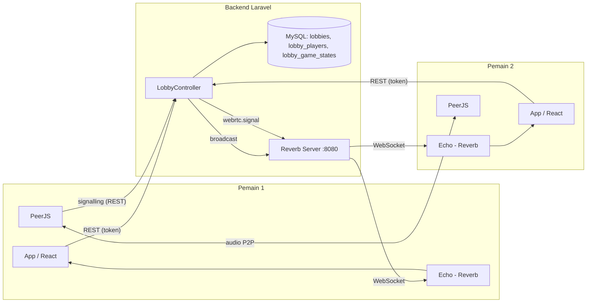
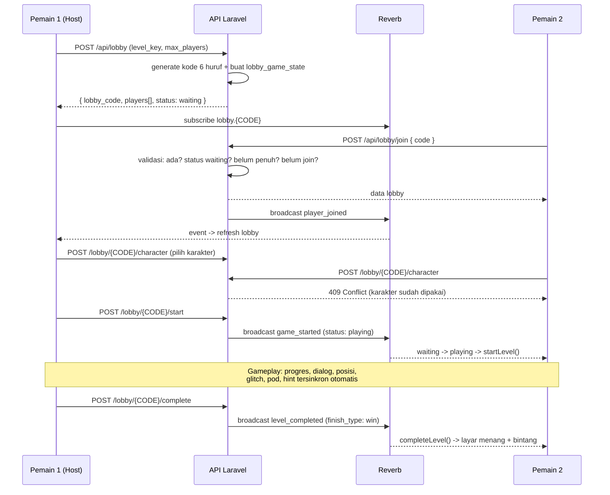

# Mekanisme Mode Multiplayer — The Paradox Room

Dokumen ini menjelaskan **bagaimana mode multiplayer bekerja** dari A sampai Z: pembuatan lobby, kode, pemilihan karakter, chat, voice, realtime, pengelolaan state, sampai akhir sesi.

> Dua repo: **`escape-room`** (frontend React + Vite, `:5173`) dan **`escape-room-api`** (backend Laravel + Filament, `:8000`, WebSocket Reverb `:8080`).

---

## Daftar isi

1. [Gambaran besar](#1-gambaran-besar)
2. [Alur lengkap satu sesi](#2-alur-lengkap-satu-sesi)
3. [Pembuatan lobby & kode](#3-pembuatan-lobby--kode)
4. [Join lobby & validasi](#4-join-lobby--validasi)
5. [Pemilihan karakter](#5-pemilihan-karakter)
6. [Realtime (Reverb)](#6-realtime-reverb)
7. [Voice chat (PeerJS)](#7-voice-chat-peerjs)
8. [Chat teks](#8-chat-teks)
9. [Pengelolaan state](#9-pengelolaan-state)
10. [Sinkronisasi aksi gameplay](#10-sinkronisasi-aksi-gameplay)
11. [Level 7 (spesial)](#11-level-7-spesial)
12. [Akhir sesi & disconnect](#12-akhir-sesi--disconnect)
13. [Daftar endpoint](#13-daftar-endpoint)
14. [Hambatan yang sudah ditangani](#14-hambatan-yang-sudah-ditangani)

---

## 1. Gambaran besar

Multiplayer memakai **dua teknologi realtime dengan tugas berbeda**:

| Teknologi | Tugas | Karakter |
|---|---|---|
| **Laravel Reverb** (WebSocket) | "Radio pengumuman" — semua data game: state lobby, progres, dialog, posisi karakter | Server (arbiter), channel per lobby |
| **PeerJS** (WebRTC P2P) | "Telepon" — suara antar pemain langsung | Audio stream langsung antar browser, lewat server hanya untuk tukar alamat (signaling) |



**Prinsip utama:** *server adalah arbiter*. Client boleh optimistic (langsung tampil), tapi keputusan final selalu di server (mis. karakter sudah dipakai → HTTP 409).

---

## 2. Alur lengkap satu sesi



---

## 3. Pembuatan lobby & kode

**`POST /api/lobby`** (butuh login — Bearer token)

```php
$maxPlayers = $request->level_key === 'level_7' ? 2 : ($request->max_players ?? 4);

$lobby = Lobby::create([
    'code'      => Lobby::generateCode(),   // 6 huruf acak, unik
    'host_id'   => $player->id,
    'level_key' => $request->level_key,
    'status'    => 'waiting',
    'max_players' => $maxPlayers,
]);
```

- **Kode lobby** = `Str::random(6)` uppercase, diulang sampai unik → seperti kode game Eternal Return, diketik manual pemain kedua.
- **Level 7 dibatasi 2 pemain** (2 karakter: Katsuragi + karakter yang dibebaskan pod); level 1–6 sampai 4 pemain.
- **Host otomatis masuk** sebagai `role = host`, `is_ready = true`.
- **Dilindungi**: kalau pemain masih punya lobby aktif (`waiting`/`playing`) → **409** + kode lobby lamanya, supaya tidak punya 2 sesi.
- Sesi awal `lobby_game_states` dibuat (revision 0) — inilah "state bersama" milik tim.

---

## 4. Join lobby & validasi

**`POST /api/lobby/join`** dengan `{ code }` (6 karakter, otomatis uppercase).

Urutan validasi di server:

| Kondisi | Hasil |
|---|---|
| Kode tidak ada | 404 "Kode lobby tidak ditemukan" |
| Lobby sudah `playing`/`finished` | 403 "Game sudah dimulai atau sudah selesai" |
| Lobby penuh | 403 "Lobby sudah penuh" |
| Sudah join sebelumnya | **200** + data lobby (idempoten, aman saat double-click) |
| Semua lolos | 200 + attach pivot `role=member`, `is_ready=false` + broadcast `player_joined` |

**Pemulihan sesi:** `GET /api/lobby/my` → mengembalikan lobby aktif pemain. Dipakai setelah refresh halaman / reconnect supaya pemain tidak kehilangan sesi.

---

## 5. Pemilihan karakter

Ada **tiga jenis** karakter, dan sengaja dipisah agar tidak saling menimpa:

| Endpoint | Makna | Sumber kebenaran |
|---|---|---|
| `POST /lobby/{code}/character` | Karakter **pilihan di lobby** (ganti boleh kapan saja) | pivot `lobby_players.character` |
| `POST /lobby/{code}/release` | Melepas karakter pilihan lobby | pivot `character` → null |
| `POST /lobby/{code}/pod-release` | Karakter yang **benar-benar dibebaskan dari pod** (level 7) | `lobby_game_states.released_character` |
| `POST /lobby/{code}/select-scene5-char` | Karakter **scene 5 per pemain** (level 7) | pivot `scene5_character` |

**Server sebagai arbiter (anti bentrok):**

```php
// assignCharacter / selectScene5Character
if ($lobby->players()->where('character', $char)->where('players.id', '!=', $playerId)->exists()) {
    return response()->json(['message' => 'Karakter sudah dipakai pemain lain.'], 409);
}
```

Client hanya melakukan validasi tampilan (tombol disabled + notifikasi "SUDAH DIPILIH PEMAIN LAIN"), sumber data daftar pilihan berasal dari `scene5Choices` (peta `playerId → character`) yang dibangun dari data lobby.

> Kenapa `pod-release` dipisah dari `release`? Karena dulu satu endpoint dipakai untuk dua maksud → karakter bisa "terlihat sudah dibebaskan pod" padahal pod belum disentuh. Sekarang `released_character` hanya bisa diisi lewat endpoint yang benar.

---

## 6. Realtime (Reverb)

### 6.1 Arsitektur channel

| Channel | Jenis | Isi |
|---|---|---|
| `lobby.{CODE}` | publik | Semua event state game: `game.state.updated`, `chat.message.sent`, `webrtc.signal` |
| `private-maze.{CODE}` | privat | **Whisper posisi karakter** di mini-game (data sensitif & sering) |

Channel privat butuh otorisasi: `POST /api/broadcasting/auth` dengan Bearer token + `routes/channels.php` yang hanya mengizinkan anggota lobby.

### 6.2 Side server

Setiap aksi gameplay memanggil helper yang sama:

```php
broadcast(new GameStateUpdated(
    lobbyCode:   $lobby->code,
    state:       $this->gameStateArray($lobby),   // snapshot state bersama
    triggeredBy: $request->user()->username,
    action:      'puzzle_solved',
));
```

`GameStateUpdated` memakai `ShouldBroadcastNow` → dikirim langsung (bukan antre di queue).

### 6.3 Side client

`src/lib/multiplayer.ts` adalah **pemilik tunggal channel** (dulu `useLobby()` di-instansiasi 4× sehingga sinkronisasi tidak pernah sampai ke peer).

```ts
channel = echo.channel(`lobby.${code}`);
channel.listen('.game.state.updated', (e) => {
  emit({ state: e.state, action: e.action, triggeredBy: e.triggeredBy, revision: e.revision });
});
```

**Pagar revisi (anti state mundur):**

```ts
if (typeof event.revision === 'number') {
  if (event.revision < lastRevision) return;   // abaikan event basi
  lastRevision = event.revision;
}
```

Server menaikkan `revision` setiap kali state berubah, jadi event lama (mis. broadcast yang telat) tidak bisa menimpa state yang lebih baru.

### 6.4 Tiga jalur data (backup berlapis)

1. **Realtime** — event WebSocket (jalur utama, < 100 ms).
2. **Polling 3 detik** — `useLobby` melakukan `GET /lobby/{code}` secara berkala; hasilnya hanya dipakai kalau revisinya lebih baru (`publishIfNewer`).
3. **Trigger refresh** — event penting (`player_joined`, `player_left`, `game_started`, `level_completed`, …) memicu refresh langsung.

### 6.5 Posisi karakter: jalur cepat (whisper)

Untuk data yang berubah puluhan kali per detik, HTTP tidakLayak (server dev 1 worker hanya ~3–5 req/detik). Posisi dikirim lewat **client event (whisper)** di channel privat:

```ts
mazeChannel.whisper('pos', { key: 'brainmaze_main', x, y, dir, frame });
```

Di sisi penerima, posisi **diinterpolasi** (buffer beberapa sampel, render 100 ms di belakang sampel terakhir) sehingga gerakan mulus di 60 fps walau informasinya hanya dikirim ~20×/detik.

---

## 7. Voice chat (PeerJS)

Voice memakai **WebRTC peer-to-peer**; server hanya jadi "penunjuk jalan" (signaling).

```ts
// 1) Peer ID unik & deterministik
const peerId = `${lobbyCode}-${username}`.replace(/[^a-zA-Z0-9-]/g, '-');
const peer = new Peer(peerId, { config: { iceServers: [...] } });

// 2) Saat siap, umumkan ke lobby
peer.on('open', () => {
  fetch(`/lobby/${lobbyCode}/signal`, {
    method: 'POST',
    body: JSON.stringify({ signal: { type: 'ready', peerId }, to: null }),
  });
});

// 3) Peer yang baru masuk →Kita yang menelepon
channel.listen('.webrtc.signal', (e) => {
  if (e.signal?.type !== 'ready') return;
  const call = peerRef.current.call(e.signal.peerId, streamRef.current);
  call?.on('stream', playRemoteAudio);
});

// 4) Yang telepon → jawab dengan stream kita
peer.on('call', (call) => { call.answer(stream); call.on('stream', playRemoteAudio); });
```

- `getUserMedia` dengan **echo cancellation + noise suppression** (supaya tidak feedback).
- Audio remote dipasang ke elemen `<audio>` yang disembunyikan.
- `stopVoice()` → `peer.destroy()` → audio berhenti.
- Sinyal dikirim lewat event `WebRTCSignal` (broadcastAs `webrtc.signal`) dengan field `to` (null = ke semua).

---

## 8. Chat teks

Sederhana: **tidak disimpan** (ephemeral, hilang saat lobby ditutup).

```
Kirim  → POST /lobby/{code}/chat { message }
Server → broadcast ChatMessageSent ('.chat.message.sent')
Client → append ke list messages lokal
```

`useChat` subscribe ke channel `lobby.{code}` dan menambah pesan baru ke state lokal. Server membungkus payload dengan username pengirim (bukan dari client) supaya nama tidak bisa dipalsukan.

---

## 9. Pengelolaan state

### 9.1 Satu store (Zustand) untuk semua

`src/store/gameStore.ts` — state divided dua:

| Jenis | Contoh | Sync? |
|---|---|---|
| **Lokal** (per pemain) | scene aktif, modal zoom/note, inventory lokal, key yang ditekan, timer |  tidak |
| **Bersama** (per tim) | `solvedPuzzles`, `usedHotspots`, `foundTreasures`, `characterInventories`, `discoveredClues`, `currentSceneId`, `timeElapsed`, `finishType`, `puzzleInputs`, `hintTokens`, `releasedCharacter`, `scene5Character`, `timerPaused`, `glitchedReactors`, `fakeReactors`, `podLoggedIn` |  via lobby state |

### 9.2 Aturan merge (satu fungsi, satu tempat)

Semua state bersama masuk lewat **`applySharedGameState()`**:

```ts
// Progres = monoton → union (tidak pernah hilang karena telat arrive)
patch.solvedPuzzles = union(s.solvedPuzzles, state.solved_puzzles);

// Snapshot = daftar penuh → replace (hasil edit admin langsung berlaku)
patch.treasures = state.treasures;

// Gangguan: daftar + daftar "sudah diperbaiki"
patch.glitchedReactors = union(s.glitchedReactors, state.glitched_reactors)
  .filter(id => !union(state.glitched_cleared, s.pendingGlitchClears).includes(id));
```

### 9.3 Optimistic update

Client langsung mengubah state lokal (biar responsif), lalu mengirim ke server. Kalau server menolak (mis. karakter sudah dipakai → 409), client mengembalikan state & menampilkan notifikasi.

---

## 10. Sinkronisasi aksi gameplay

Semua aksi ini punya aksi sync-nya sendiri di `multiplayer.syncAction()`:

| Aksi | Event | Isi state bersama |
|---|---|---|
| Puzzle terpecahkan | `puzzle_solved` | `solved_puzzles` |
| Hotspot dipakai | `hotspot_used` | `used_hotspots` |
| Item diambil | `item_collected` / `item_removed` | `inventory` (level 1–6), `character_inventories` (level 7) |
| Clue ditemukan | `clue_discovered` | `discovered_clues` |
| Treasure ditemukan | `treasure_found` | `found_treasures` |
| Ganti scene | `scene_changed` | `current_scene_id` |
| Inventory per karakter | `character_state` | `character_inventories` |
| Gangguan reactor | `reactor_state` | `glitched_reactors`, `fake_reactors`, `*_cleared` |
| Pause/resume | `timer_paused` | `timer_paused` |
| Hint dipakai | `hint_used` | `shared_hint_tokens`, `shared_hints_used` |
| Login pod | `pod_login` | `pod_logged_in` |

**Contoh sinkronisasi timer:** satu pemain menekan Pause → `timer_paused` disiarkan → pemain lain memanggil `pauseTimer()` + melihat overlay "X menjeda game" (state `remotePaused`).

**Spezial level 7:** inventory tidak lagi bersama, tapi **per karakter** (`character_inventories`), karena level 7 memindahkan item antar karakter (pod, transfer reactor). Untuk inventory milik **pasangan**, server yang berwenang; milik sendiri tetap lokal supaya tidak berkedip hilang sebelum sinkronisasi sampai.

---

## 11. Level 7 (spesial)

| Fitur | Mekanisme |
|---|---|
| **Pod** | Satu tim, satu karakter yang dibebaskan → `released_character` (shared). Setelah itu karakter itu boleh dipilih siapa pun di scene 5 → `scene5_character` (per pemain, unik). |
| **X-Vision & Translate** | Milik karakter masing-masing (lokal), karena skill dipakai bergantian. |
| **Gangguan (glitch / fake info)** | `reactor_state` → shared. Glitch/solve memakai `glitchAdd`/`glitchClear` supaya bisa dihapus (bukan monotonic). |
| **Maze multiplayer** | Posisi karakter via whisper di channel privat + interpolasi. |
| **Maks 2 pemain** | Dipaksa di `create()` (level_7 → max_players = 2). |

---

## 12. Akhir sesi & disconnect

**`finish_type`** di `lobby_game_states` menentukan akhir sesi:

| Nilai | Pemicu | Hasil |
|---|---|---|
| `win` | Semua level selesai → `POST /lobby/{code}/complete` | Bintang + WinScreen |
| `lose` | Pemain kalah → `POST /lobby/{code}/lose` | LoseScreen |
| `abandon` | Pemain keluar di tengah game | **Tanpa bintang**, notifikasi, kembali ke menu |

Default `finish_type` sengaja `'abandon'` — kalau default-nya `'win'`, pemain yang keluar akan tetap mendapat bintang padahal level belum selesai.

**Deteksi disconnect:** polling 3 detik + event `player_left` membandingkan jumlah pemain. Bila jumlah turun saat status `playing` → sesi ditandai abandon, pemain diberi notifikasi ("Salah satu player telah keluar") lalu dikembalikan ke splash.

**Endpoint keluar ada dua:**
- `POST /lobby/{code}/leave` → keluar biasa (mencatat bookmark, tidak menghapus state).
- `POST /lobby/{code}/exit` → keluar paksa (exit beacon) untuk player yangreqqwewer blowing up.

---

## 13. Daftar endpoint

| Method | Endpoint | Fungsi |
|---|---|---|
| POST | `/api/lobby` | Buat lobby (host) |
| POST | `/api/lobby/join` | Join dengan kode |
| GET | `/api/lobby/my` | Lobby aktif saya (recovery) |
| GET | `/api/lobby/{code}` | Snapshot lobby + game_state |
| POST | `/api/lobby/{code}/start` | Host memulai game |
| POST | `/api/lobby/{code}/sync` | Aksi gameplay (puzzle, hotspot, item, hint, reactor, pod, timer) |
| POST | `/api/lobby/{code}/input` | Input puzzle (termasuk posisi karakter, jalur cadangan) |
| POST | `/api/lobby/{code}/character` | Pilih karakter lobby (409 bila dipakai) |
| POST | `/api/lobby/{code}/release` | Lepas karakter lobby |
| POST | `/api/lobby/{code}/pod-release` | Karakter yang dibebaskan pod |
| POST | `/api/lobby/{code}/select-scene5-char` | Pilih karakter scene 5 (409 bila dipakai) |
| POST | `/api/lobby/{code}/chat` | Kirim chat |
| POST | `/api/lobby/{code}/signal` | Signaling WebRTC (voice) |
| POST | `/api/lobby/{code}/complete` / `/lose` | Selesai / kalah |
| POST | `/api/lobby/{code}/leave` / `/exit` | Keluar dari lobby |
| POST | `/api/lobby/{code}/reset` | Reset sesi (host) |
| POST | `/api/broadcasting/auth` | Otorisasi channel privat |

---

## 14. Hambatan yang sudah ditangani

| Masalah | Solusi |
|---|---|
| State gangguan hanya di browser → glitch tidak terlihat pemain lain | State bersama + event `reactor_state` |
| Server hanya bisa menambah daftar → glitch "muncul lagi" setelah diperbaiki | Protokol add/clear + daftar `*_cleared` |
| Posisi karakter lambat & patah-patah | Whisper WebSocket + interpolasi + backpressure (bukan HTTP per frame) |
| `useLobby()` di-instansiasi 4× → sinkronisasi tidak sampai | `multiplayer.ts` jadi pemilik tunggal channel |
| Event basi menimpa state baru | Pagar `revision` monoton |
| Karakter sama dipakai 2 pemain | Server arbiter → 409 + tombol disabled |
| "Pod sudah dibebaskan" ambigu | Endpoint `release` vs `pod-release` dipisah |
| Pemain keluar dianggap menang (false win) | `finish_type` default `abandon` |
| Gangguan belum bisa diperbaiki bersama | `glitchClear`/`fakeClear` + `pendingClears` anti-kedip |
| Channel lobby bisa disimak pihak lain | Channel privat `maze.{code}` + auth Sanctum |

---

*Dokumen ini dibuat dari kode aktual project (frontend `src/hooks/useLobby.ts`, `src/lib/multiplayer.ts`, `src/hooks/useVoiceChat.ts`, `src/hooks/useChat.ts`, backend `app/Http/Controllers/Api/LobbyController.php`, `app/Events/*`).*
